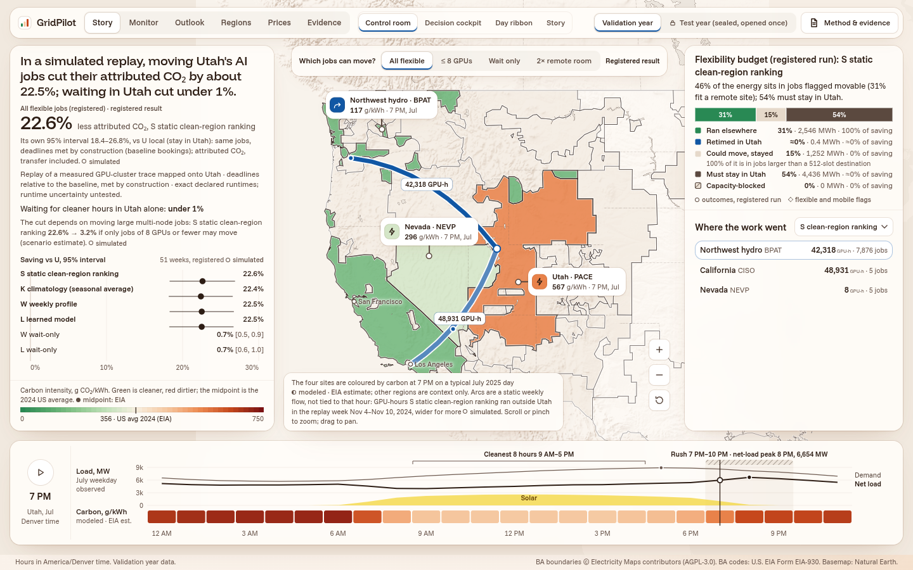
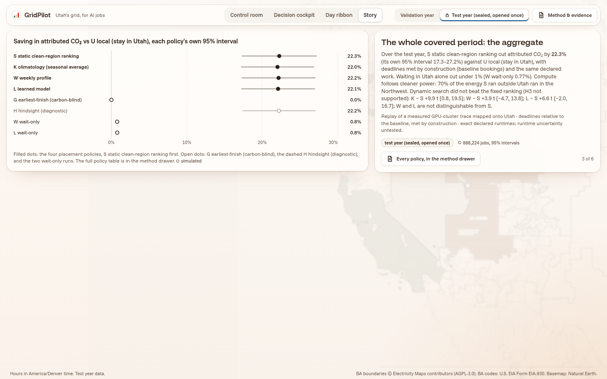
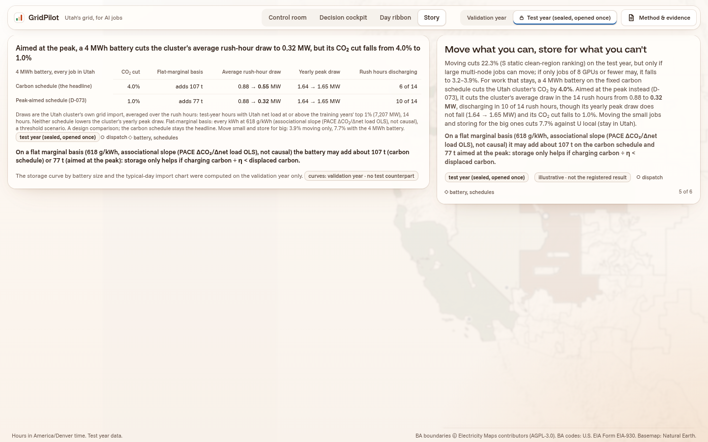
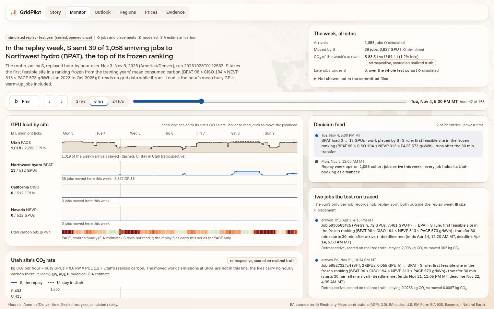
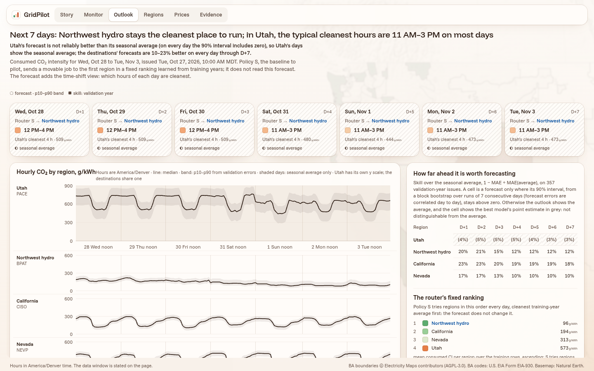
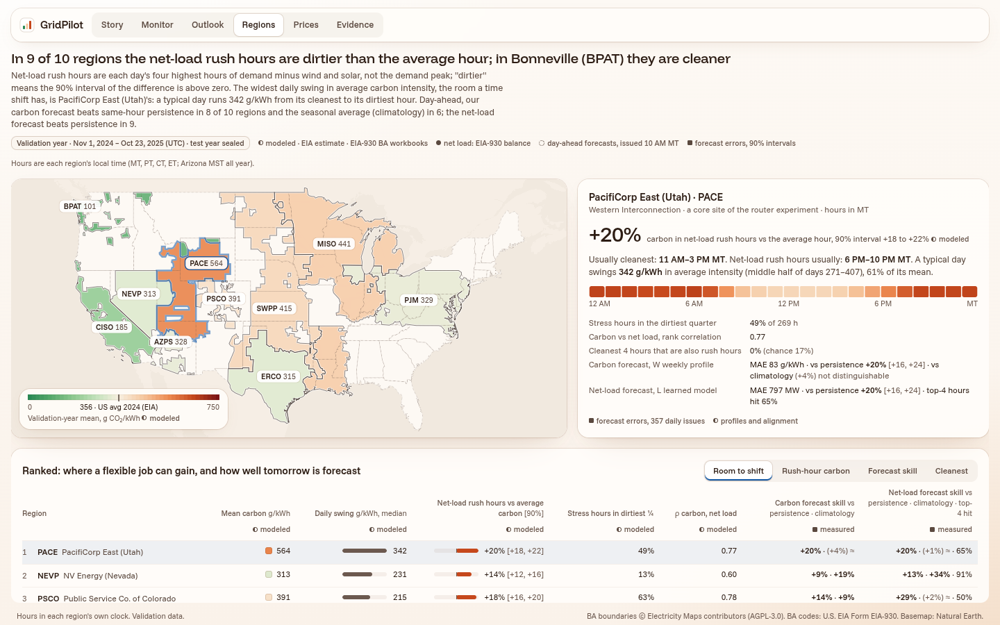
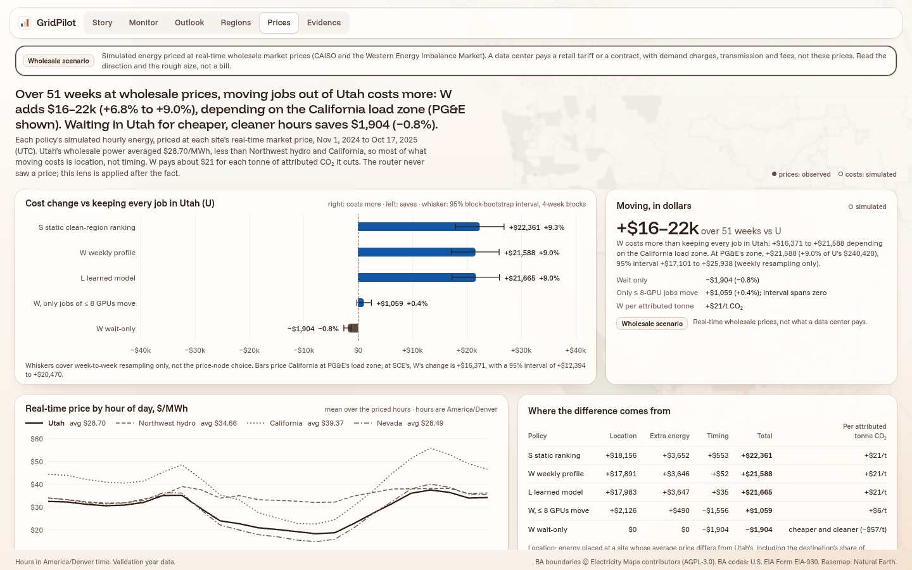
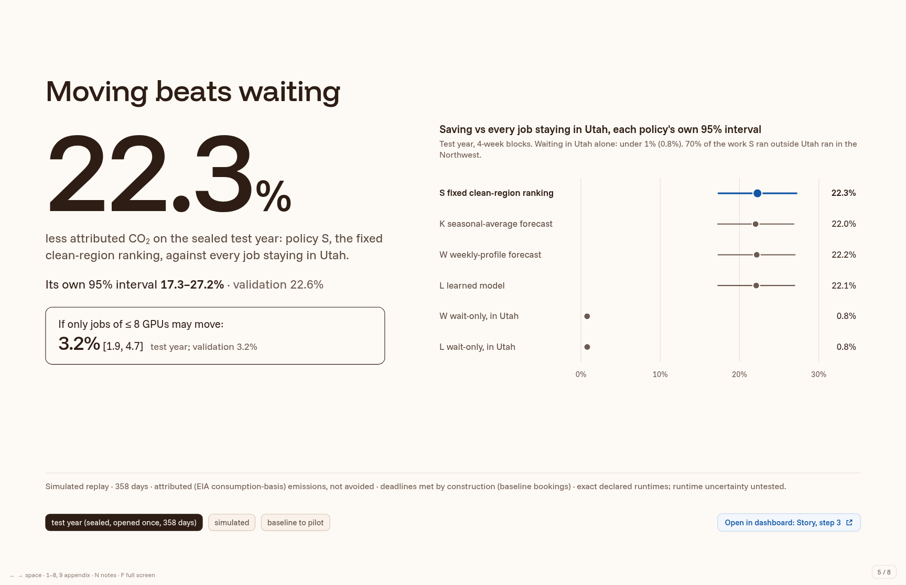

# GridPilot: compute follows cleaner power

**Hard Tech Week 2026 · Torus bounty "Energy × AI Infrastructure".** The project answers Option 2, *Compute Follows the Sun*, and builds its engine from Option 1, *Rush Hour for Electrons*.

GridPilot is a day-ahead **traffic report for the grid** combined with a **router for AI jobs**. The router decides whether each job should **move** to a cleaner region, **wait** for a cleaner hour, or stay put while a battery **stores** for the rush. We tested it in a simulated replay of a real GPU-cluster workload on real US grid data, with **Utah (PacifiCorp East, PACE)** as the home region.



## The result

| | Sealed test year (358 days, opened once) | Validation year |
|---|---|---|
| **Move jobs to cleaner regions (policy S, a fixed clean-region ranking)** | **22.3% less attributed CO₂** [95% CI 17.3–27.2] | 22.6% [18.4–26.8] |
| Wait for cleaner hours in Utah only | 0.8% | 0.7% |
| Forecast-based routing (K, W, L) vs the fixed ranking | no demonstrated benefit | no demonstrated benefit |
| **If only jobs of ≤ 8 GPUs can move** | **3.2%** [1.9–4.7] | 3.2% |
| Storage, 4 MWh aimed at carbon | ~4% less CO₂, but it **adds** CO₂ on a flat marginal basis | 3.5% |
| Storage, 4 MWh aimed at Utah's rush hour | average rush-hour draw 0.88 → 0.32 MW; ~1% CO₂ | — |

**What it means:**
- **Moving beats waiting.** About 70% of the moved work ran on Northwest hydro (BPAT).
- **The saving rests on mobility.** The top 1% of jobs use about 95% of the energy, so the pilot question for an operator is whether the biggest jobs can move their data and checkpoints.
- **Storage can be aimed at carbon or at the rush, not both.**

All numbers are **simulated** and **attributed** (EIA consumption-basis emissions), not measured avoided emissions. Policy S is a **baseline to pilot**, not a deployment.

## How it was tested

1. **Data.** We used free, open data: EIA-930 hourly balance, EIA's hourly CO₂ by balancing area (PACE, BPAT, CISO, NEVP), and the Acme "Seren" GPU-cluster trace (2,288 GPUs, about 818k jobs).
   - The trace is replayed onto 2024–26.
   - Each source's URL, retrieval time and sha256 are in `data/manifests/`.
2. **Splits.**
   - Training data runs up to Oct 2024.
   - The validation year (Nov 2024 – Oct 2025) was used for every design choice.
   - The **test year (Nov 2025 – Oct 25, 2026) stayed sealed**: no value was read until the configuration was frozen.
3. **No lookahead.** A forecast uses only data that would already have been published (CO₂ about 96 h late, wind and solar 48 h, demand 2 h).
4. **Freeze, then open once.**
   - An independent rebuild from raw data reproduced the validation run hash for hash.
   - The configuration was frozen and tagged (`config-freeze`).
   - The test year was then opened **once** (Oct 27, 19:22 MT), with every read logged (`results/test_reads.jsonl`).
   - Secondary analyses were pre-registered before the opening (`docs/decisions.md`, D-071 and D-073).
5. **Simulation.** It is gang-scheduled and conserves work: every job completes the same GPU-seconds, deadlines are met by construction, and capacity limits hold at every site.
6. **Statistics.** Intervals come from a paired circular block bootstrap (4-week blocks, with 2 and 8 as checks; 2,000 reps).
7. **Reviews.** Independent AI reviewers checked every piece and caught real errors before the seal opened. The full log is in `docs/decisions.md` and `docs/reviews/`.

> AI agents (Claude Code, with Codex as reviewer) helped build and review this project. The routing policy itself is a fixed ranking, not an AI agent.

## The app

The offline dashboard (`web/`) has a top bar with six pages.

| Page | What it shows |
|---|---|
| **Story** | A guided walkthrough: Utah's rush hour, one job's choice, the test-year result, the mobility condition, storage. |
| **Monitor** | An operator console replaying the router hour by hour on the test year (simulated). |
| **Outlook** | A 7-day grid outlook. Destination forecasts beat their seasonal average by 10–23%; Utah's are not reliably better. |
| **Regions** | Ten US regions: in 9 of 10, the net-load rush hours are dirtier than average; Bonneville is cleaner. |
| **Prices** | A wholesale-price scenario: moving costs $16–22k more over 51 weeks (+7–9%), about $21 per attributed tonne. |
| **Evidence** | Assumptions, method, and the full validation → test drift table. |

| Story: the test-year result | Story: storage, carbon vs rush |
|---|---|
|  |  |

| Monitor | Outlook |
|---|---|
|  |  |

| Regions | Prices |
|---|---|
|  |  |

**The pitch deck** (`docs/pitch/deck/index.html`) is offline HTML. Every number on it is checked automatically against `results/`.



## Run it

**Requirements:** Node 20+ and `make`. Python 3.12 with `uv` is needed only for the lab.

```sh
git clone https://github.com/ratulalahy/26_hard_tech_week_hackathon.git
cd 26_hard_tech_week_hackathon
make web                         # copy results into the app and build it
cd web && npm run preview        # http://127.0.0.1:4173/?year=test
```

- **Deck:** open `docs/pitch/deck/index.html` in Chrome. Use ← / → to move through it, P for the presenter view and F for full screen.
- **Lab:** `cd lab && uv run pytest` runs the tests. `AGENTS.md` lists every command (`make slice`, `make storage`, `make outlook`, and the rest).

## Repository map

| Path | Contents |
|---|---|
| `lab/` | Python package `gridpilot`: data pipeline, forecasters (K, W, L), simulator, policies, the seal, evaluation |
| `results/` | The committed outputs the app reads; test-year outputs are in `results/test/` |
| `web/` | The dashboard (Vite, React, TypeScript, MapLibre, ECharts) |
| `config/freeze.json` | The configuration freeze record (tag `config-freeze`) |
| `docs/decisions.md` | Every decision, with evidence (D-001 to D-075) |
| `docs/pitch/` | Script, Q&A, one-pager, numbers card, deck |
| `docs/reviews/` | Independent reviews and their dispositions |

## Limits, stated plainly

- **The emissions are simulated and attributed, not avoided.** We use average consumption-basis carbon intensity, and dispatch response is not modelled.
- **Mobility, spare capacity and transfer costs are assumptions.** Runtimes are exact, so overruns are untested.
- **The data is a revised EIA snapshot, not the data as it was first published.** The publication delays are assumed.
- **The workload is a 2023 trace replayed onto 2024–26,** and energy per GPU-hour is assumed.
- **Storage, water and prices are illustrative scenarios.** Prices are wholesale, not what a data center pays.

Data licences are recorded per source in `data/manifests/`.
