# Grid data profile: EIA-930 and archived weather forecasts

> **Correction (2026-10-27, D-062 / Astra F26):** where this profile says the marginal regression "identifies" marginal emissions or gives the "honest avoided-emissions answer", that wording is superseded. Per the approved spec (§10, F7), the regression is an **associational emissions-response proxy**, not a causal marginal factor. No avoided-emissions claim follows from it. Pitch materials use the spec's wording.

Data recon for the experiment design. Written 2026-10-26 (MT); EIA data retrieved 2026-10-27 04:57Z.

- **Seal.** Every statistic, figure and sample here uses hours before 2025-11-01T00:00Z only (train + validation, through `gridpilot.splits.drop_sealed`). The sealed test window appears in exactly two places, both completeness-only: §3.3 (row counts and missing hours per BA) and the weather null counts in §9.
- **Snapshot.**
  - EIA inputs are frozen: `data/manifests/eia930.json` has 51 files and 3,841,579,327 bytes, manifest sha256 `08b852396a0a6d9a093959f2930c684b720199c2392824180f5720c4fd5886fc`.
  - Tidy tables: `balance.parquet` sha256 `f63d0c2703c6e42a1bbdabc9ff746ab0405cbc72b1c5a9dad8c6251ef29d0e86`; `interchange.parquet` sha256 `5959a90cfae7f13796ad091c5973e97e37c86b9d9b1b06d909836177a66cbb4e`.
  - `data/manifests/openmeteo.json` was **still growing** when this was written (background downloads; §9). Hash it once the downloads finish, before any analysis uses it.
- **Evidence labels** (`.claude/skills/hackathon-evidence`): EIA-930 values, including the BA's own forecast, are *observed*. Carbon intensity from fuel mix × factors is *modeled*, and so is EIA's own CO2 estimate. Weather from Open-Meteo is *forecast*.
- **Validation year** below means 2024-11-01 to 2025-10-31 (UTC). **Full years** means calendar 2019–2024.
- **Reproduce:**
  - download (raw files are kept if present): `cd lab && uv run python -c "from gridpilot.data import eia930 as e; e.write_manifest(e.download(e.six_month_files('BALANCE') + e.six_month_files('INTERCHANGE')) + e.download_ba_workbooks(['PACE', 'CISO']) + [e.download_file('EIA930_Reference_Tables.xlsx', url=e.REFERENCE_TABLES_URL)])"`. Pass the full BA list to `download_ba_workbooks`; workbook entries are recorded under `ba_workbooks/`;
  - `cd lab && uv run python -c "from gridpilot.data import eia930 as e; e.build_balance(); e.build_interchange()"`;
  - then `uv run --with fastexcel python scripts/recon_grid.py <out_dir>`, which writes the tables to `<out_dir>` and the figures to `docs/data-profile/figures/grid/` in about 25 s.
  - Inputs are pinned by sha256 in `data/manifests/eia930.json`.

## Summary

1. **The data is complete enough for an hourly study from 2019 on.**
   - 47 of 67 BAs report demand in at least 99% of hours.
   - Every recommended BA reports demand in at least 99.75% of hours, and the fuel mix in at least 99.95%.
   - Every candidate BA has all 8,592 rows in the sealed window (completeness only).
2. **Utah's rush hour is a summer late afternoon, and it is narrow.**
   - All of PACE's top-100 demand hours each year fall in June–September, 76% of them between 16:00 and 21:00 local.
   - They land on only 27 days a year.
   - Demand is within 5% of the annual peak for a median 34 h/yr, on 12 days. For net load (demand minus wind and solar) it is 11 h/yr, and the net-load peak moves from 17:00 to 20:00.
3. **EIA's "adjusted" demand still contains spikes, and EIA's imputation can leak the BA forecast into the target.**
   - PACE reported 12,566 MW for 2021-09-13 21Z, when generation minus interchange was 6,512 MW. The adjusted column kept it.
   - Of 1,181 imputed candidate-BA demand hours, 996 equal the BA's day-ahead forecast exactly, because the DF is EIA's first imputation fallback.
4. **The BA's own day-ahead forecast is a strong and stable baseline for most BAs, but not all.**
   - Validation-year MAPE (imputed and spike hours excluded): SOCO 1.2%, BPAT 2.0%, ERCO and MISO 2.3%, **PACE 4.0%** (bias +2.7%).
   - CISO is at 8.1%, AZPS 8.9% and PACW 11.5%, after degrading in 2024–25.
5. **Two BAs publish the DF one hour off.**
   - PJM's DF matches demand best when shifted +1 h, in every year from 2019 to 2025 and in both DST seasons (MAPE 3.5% falls to 2.5%).
   - CISO's DF has done the same since mid-2022.
   - PACE is aligned (shift 0 is best in every year and season).
6. **The BA forecast cannot be a feature for a D-1 forecast.** EIA publishes the DF for day D at about 11:00 ET on day D. At retrieval, the DF extended only 1 h past the retrieval time.
7. **PACE is the dirtiest grid in the recommended set, and has one of the largest daily swings.**
   - It averaged 554 g CO2/kWh in the validation year (EIA's own estimate: 566), from 45% coal.
   - A 1-hour job that may wait up to 24 h cuts its CO2 by 33% with perfect foresight. The cleanest hour of each day is 32% below the day's mean, because midday solar displaces gas while coal runs flat.
   - That is an average-intensity gain. PACE's estimated *marginal* intensity stays at 498–658 g/kWh across the day (ΔCO2/Δnet-load regression, R² 0.47), so the emissions a shift really avoids are likely much smaller.
8. **Where beats when, by a wide margin.**
   - Over the validation year, the gap between the dirtiest and cleanest of the 10 recommended BAs averaged 580 g/kWh in a given hour.
   - BPAT (hydro) was cleaner than PACE in 100% of hours, CISO in 99.8% and ERCO in 96.8%.
   - Shifting PACE work in time saves at most about a third; moving it to BPAT saves 94% on a production basis, or 82% using EIA's consumption-based intensity for BPAT.
9. **Production-based and consumption-based intensity diverge for hydro BAs that import.** EIA's consumed-electricity intensity is 3.0× its generation intensity for BPAT (102 vs 34 g/kWh) and 2.4× for IPCO (249 vs 103). IPCO is PACE's largest export partner (846 MW on average).
10. **Honest archived weather forecasts start late.**
    - Only Open-Meteo's Previous Runs API with `_previous_day2` (a 48–53 h lead) is honest for a forecast issued on D−1.
    - It covers all three variables (temperature, shortwave radiation, 100 m wind) only from 2024-02-17, so 2024-03-01 is the clean start. Temperature alone is covered from 2021-03-25.
    - The Historical Forecast API (from 2018-01-01) stitches 0–5 h leads into a nowcast and leaks.

## 1. Downloads

| What | Files | Bytes | Coverage | Where |
|---|---:|---:|---|---|
| EIA-930 BALANCE six-month CSVs | 16 | 0.69 GB | 2019-01-01 to 2026-10-26 (local dates) | `data/raw/eia930/EIA930_BALANCE_*.csv` |
| EIA-930 INTERCHANGE six-month CSVs | 16 | 1.62 GB | same | `data/raw/eia930/EIA930_INTERCHANGE_*.csv` |
| EIA-930 reference tables | 1 | 45 kB | BA codes, time zones, generation-only flags, retirements | `data/raw/eia930/EIA930_Reference_Tables.xlsx` |
| Per-BA workbooks (all history, plus EIA's hourly CO2 estimates) | 18 | 1.53 GB | 2015-07 to 2026-10; CO2 from 2018-07-01 | `data/raw/eia930/ba_workbooks/{BA}.xlsx` |
| Open-Meteo archived forecasts | see §9 | | | `data/raw/openmeteo/` |

- **Manifest:** `data/manifests/eia930.json`, 51 entries, each with URL, `retrieved_at` (UTC), bytes, sha256, the server's `Last-Modified` and a license note. Raw files are read-only (0444).
- **License:** EIA data is a U.S. Government work in the public domain; EIA asks for a source acknowledgment.
- **Revisions:** EIA regenerates every file daily (all `Last-Modified` stamps are the retrieval day), so the values can be revised. The sha256 pins this snapshot.

**Hourly CO2 from EIA: yes, but not in the six-month CSVs.**
- The per-BA workbooks (`https://www.eia.gov/electricity/gridmonitor/knownissues/xls/{BA}.xlsx`, keyless, sheet "Published Hourly Data") carry, hourly from 2018-07-01:
  - BA-specific CO2 factors for coal, gas and oil (lb/kWh);
  - CO2 emissions by fuel, generated, imported, exported and consumed;
  - "Positive Generation";
  - the CO2 intensity of generated **and of consumed** electricity.
- **Method** (EIA's About page): annual BA-specific factors from EIA-923 plant data and EPA factors, CHP excluded. Consumption intensity comes from a multiregional input-output model over the BA-to-BA transfers.
- **Lag:** EIA publishes yesterday's CO2 by about 4:00 p.m. ET.

## 2. The tidy table

`data/interim/eia930/balance.parquet`:
- one row per (`ba`, `ts_utc`);
- 4,278,380 rows, 51 columns, 69 BAs, 127 MB (zstd);
- built by `gridpilot.data.eia930.build_balance()` in 2.3 s.

`data/interim/eia930/interchange.parquet` holds 20,562,362 rows of (`ba`, `diba`, `ts_utc`, `interchange_mw`), with positive meaning flow out of `ba`.

| Column(s) | Meaning | Units |
|---|---|---|
| `ba`, `region` | EIA BA code and EIA region (CAL, NW, SW, TEX, ...) | |
| `ts_utc` | **start** of the hour, UTC (EIA's "UTC Time at End of Hour" minus 1 h) | datetime[us, UTC] |
| `utc_offset_h` | local minus UTC, as published per row (DST included, except MISO, which publishes EST all year, and Arizona) | h |
| `demand_forecast_mw` | **DF**: the BA's day-ahead demand forecast for this hour, as reported; no adjusted version exists | MW (= MWh in the hour) |
| `demand_mw`, `demand_adj_mw`, `demand_imputed` | reported demand; EIA-adjusted demand (the reported value unless EIA imputed); a flag for imputed hours | MW |
| `net_gen_mw`, `net_gen_adj_mw`, `net_gen_imputed` | total net generation, the same three forms | MW |
| `interchange_mw`, `interchange_adj_mw`, `interchange_imputed` | total interchange, positive = net export | MW |
| `sum_valid_dibas_mw` | EIA's sum of the valid BA-to-BA interchange records | MW |
| `gen_<f>_mw`, `gen_<f>_adj_mw` | net generation by fuel `f`, reported and adjusted. Partition: coal, gas, oil, nuclear, hydro, solar, wind, geothermal, battery, other_storage, unknown_storage, other, unknown. Sub-columns: hydro_conv, pumped_storage, solar_batt, wind_batt | MW |
| `fuel_imputed_n` | number of fuel columns EIA imputed in this hour | count |
| `source_file` | the half-year file the row came from | |

- **Timestamps.**
  - EIA reports hour-ending integrated MW, so "Hour 1 = 12:00–1:00 AM" (workbook Notes; EIA-930 instructions: "hourly integrated values in megawatts by hour ending time").
  - We store hour-beginning UTC, so that half-open windows (including the seal) select exactly their hours.
  - A test pins this: the hour ending 2025-11-01T00:00Z is kept as train.
- **Fuel taxonomy change.**
  - From the 2024 Jul_Dec file, EIA splits hydro (WAT/PS), solar (SUN/SNB) and wind (WND/WNB), and adds battery, other storage, unknown storage and geothermal.
  - `gen_hydro`, `gen_solar` and `gen_wind` keep the old combined meaning on both sides of the change. The new sub-columns are null before 2024-07.
  - Before 2024-07, batteries and geothermal sit inside "other". Some BAs still report them there: CISO's storage is in "other" (net −0.8% of generation after the change), and NEVP's geothermal too (10.3%).
- **Header typos in the new files**, handled and tested: "Solar witho Integrated Battery Storage (Adjusted)", and "Pumped Storage  (Adjusted)" with a double space.
- **Imputation semantics,** checked on 2019, 2023 and 2025-H1:
  - `Adjusted = Imputed` where EIA imputed, otherwise `Reported`.
  - EIA imputes demand when it is missing, ≤ 0, or ≥ 1.5× the BA's past maximum. The fallbacks are the DF, then the previous hour, then the same hour the previous day.
  - We keep only a flag, not the duplicate value.
- **No duplicate (ba, ts_utc)** rows, before or after concatenation.
- **The first UTC hours of 2019 are missing** for every BA. They sit in the 2018 Jul_Dec file, which was out of scope, and explain the 0.06–0.09% "missing" in 2019 below.

## 3. Coverage and gaps

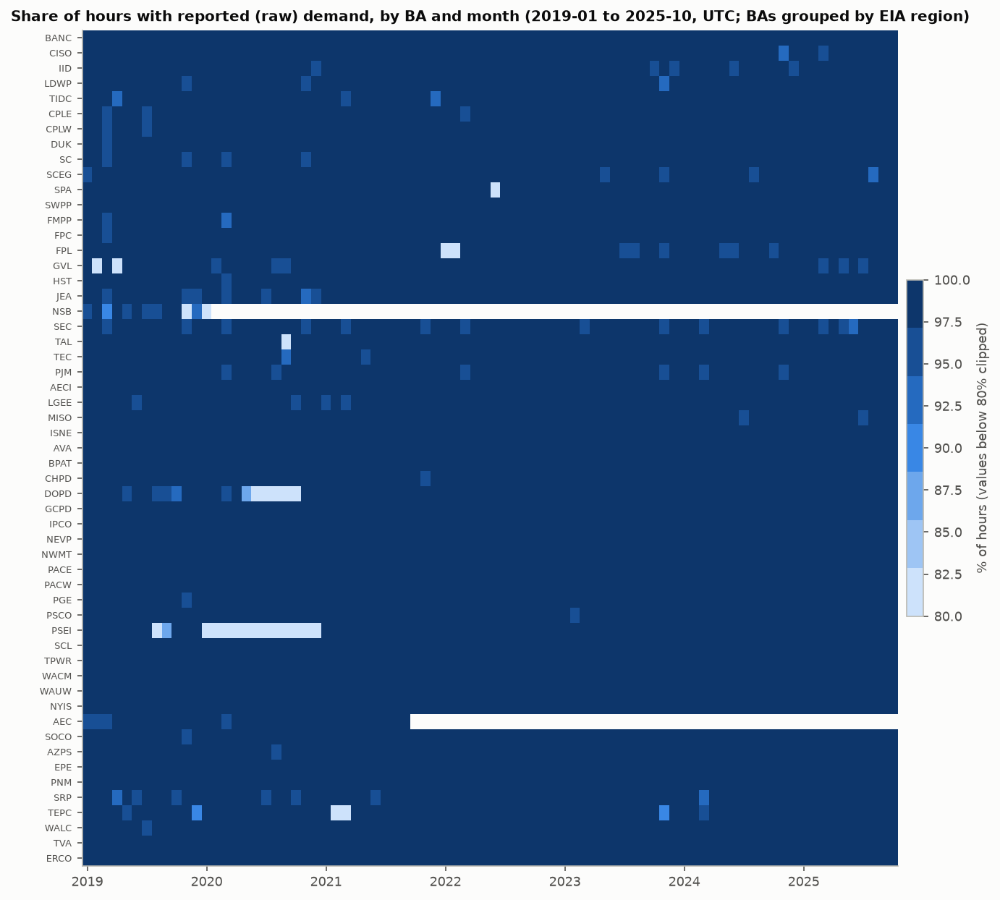

### 3.1 All BAs (2019-01 to 2025-10)

- **Population:** 67 BAs have data before the seal; 47 report demand in at least 99% of hours.
- **Generation-only BAs, which report no demand (12):** YAD, EEI, GLHB, SIKE, AVRN, GRID, GWA, WWA, SEPA, DEAA, GRIF, HGMA.
- **Retired or stopped before the seal:**
  - NSB (2020-01), EEI (2020-02), AEC (2021-09), GLHB (2022-09), GRIF (2023-11), HGMA (2025-06);
  - SIKE starts 2025-06.
- **Worst large-BA gap:** PSEI reports demand in only 84.6% of hours, and its fuel sum is 1.34× its net generation. Avoid it.
- Every BA is listed in Appendix A. The fuel-mix heatmap is `figures/grid/coverage_fuelmix_heatmap.png`.

### 3.2 Candidate BAs (2019-01 to 2025-10)

| ba | mean demand MW | demand reported % | DF reported % | fuel mix % | demand imputed h | of which replaced a reported value | h with a fuel imputed | isolated spikes h | flat-line h (runs >= 6) | h with \|D-(NG-TI)\|>5% (%) |
|---|---:|---:|---:|---:|---:|---:|---:|---:|---:|---:|
| PACE | 5,751 | 99.99 | 99.98 | 99.99 | 1 | 1 | 61 | 7 | 0 | 0.0 |
| CISO | 25,130 | 99.83 | 99.87 | 99.95 | 70 | 0 | 542 | 28 | 0 | 42.9 |
| BPAT | 6,544 | 99.99 | 99.99 | 99.99 | 0 | 0 | 38 | 9 | 0 | 93.9 |
| AZPS | 3,771 | 99.95 | 99.47 | 99.99 | 45 | 21 | 53 | 23 | 0 | 7.4 |
| NEVP | 4,461 | 99.96 | 99.88 | 99.99 | 24 | 6 | 24 | 4 | 0 | 3.1 |
| PSCO | 5,284 | 99.95 | 98.62 | 99.99 | 37 | 13 | 380 | 23 | 0 | 0.3 |
| ERCO | 48,631 | 99.99 | 99.99 | 99.99 | 0 | 0 | 0 | 0 | 0 | 0.0 |
| SWPP | 31,775 | 99.99 | 99.83 | 99.99 | 2 | 1 | 2 | 1 | 1941 | 0.8 |
| MISO | 73,671 | 99.89 | 99.87 | 99.99 | 58 | 0 | 58 | 0 | 0 | 1.1 |
| PJM | 91,448 | 99.75 | 99.67 | 99.99 | 147 | 7 | 144 | 8 | 0 | 7.2 |
| IPCO | 2,080 | 99.99 | 99.99 | 99.99 | 0 | 0 | 0 | 3 | 0 | 0.0 |
| NYIS | 17,271 | 99.99 | 99.72 | 99.98 | 0 | 0 | 40 | 0 | 0 | 0.0 |
| ISNE | 13,175 | 99.99 | 99.99 | 99.99 | 2 | 0 | 1 | 0 | 0 | 0.0 |
| SOCO | 26,910 | 99.95 | 99.94 | 99.99 | 27 | 3 | 30 | 1 | 0 | 5.0 |
| FPL | 15,691 | 98.73 | 99.73 | 99.11 | 740 | 10 | 229 | 15 | 0 | 0.3 |
| TVA | 18,438 | 99.99 | 99.88 | 99.99 | 5 | 4 | 2 | 7 | 0 | 0.0 |
| DUK | 12,101 | 99.95 | 99.95 | 99.99 | 23 | 0 | 104 | 0 | 0 | 0.0 |
| PACW | 2,388 | 99.99 | 99.99 | 99.99 | 0 | 0 | 0 | 12 | 0 | 0.0 |

By year (`missing_*_pct_by_year.csv`), missing hours stay below 1.0% per candidate-year with these exceptions:
- FPL 2022: 6.3% of demand and 5.8% of the fuel mix missing;
- FPL 2023: 1.1% of demand;
- PSCO 2019: 8.9% of the DF;
- AZPS 2019: 3.1% of the DF.

### 3.3 Sealed window: completeness only

Window: 2025-11-01T00Z to 2026-10-25T00Z, 8,592 expected hours. Only counts are shown.

| ba | rows | missing rows | missing demand hours | missing DF hours |
|---|---:|---:|---:|---:|
| PACE | 8592 | 0 | 0 | 72 |
| CISO | 8592 | 0 | 54 | 48 |
| BPAT | 8592 | 0 | 0 | 0 |
| AZPS | 8592 | 0 | 14 | 0 |
| NEVP | 8592 | 0 | 0 | 0 |
| PSCO | 8592 | 0 | 0 | 0 |
| ERCO | 8592 | 0 | 48 | 48 |
| SWPP | 8592 | 0 | 24 | 480 |
| MISO | 8592 | 0 | 14 | 24 |
| PJM | 8592 | 0 | 47 | 48 |
| IPCO | 8592 | 0 | 0 | 0 |
| NYIS | 8592 | 0 | 0 | 0 |

- All 18 candidate BAs have every row.
- **BA-set change inside the window** (row counts only):
  - WACM has 3,631 of 8,592 rows and WAUW 3,630, so both stop reporting around 2026-04-01.
  - New codes SWPW (4,963 rows) and BHBA (4,962) start then.
  - WACM is PACE's largest import neighbour (§8). Interchange-based features or consumption-based carbon for PACE must handle the switch.
- **SWPP** misses 480 DF hours in the window, so its DF baseline needs a missing-value rule.
- The latest rows (up to 2026-10-27 06Z) carry only the DF, for the rest of the retrieval day.

## 4. Outliers, and adjusted vs raw values

- **EIA's adjustments are rare.** EIA imputed demand in 0–147 h per candidate over 6.8 years (PJM highest), except FPL (740 h, mostly 2022 gaps). Nearly all of these are *missing* reported values that EIA filled.
- **The few values EIA replaced are absurd.**
  - Median change where EIA replaced a reported value: 93% (AZPS) to 27,000% (TVA) of mean demand. These are unit or keying errors.
  - PJM's 7 replaced raw values are so large that their |adjusted − raw| sums to 75% of PJM's entire 2019–2025 demand energy.
  - Raw demand needs the adjusted column or our own filter.
- **Adjusted demand still has isolated spikes.**
  - Rule: more than 15% from the mean of both neighbours, while the neighbours agree within 10%.
  - It flags 0–28 hours per candidate (table in §3.2), e.g. PACE's 12,566 MW hour on 2021-09-13 21Z (NG − TI = 6,512 MW).
  - Uncleaned, that one hour turns PACE's 2021 "hours within 5% of peak" from 40 into 1.
  - The profile uses `demand_clean_mw` (adjusted, spikes and values ≤ 0 removed).
- **Flat lines:** SWPP has 59 runs of 6 or more identical hourly values (1,941 h, 2019-03 to 2025-10). No other candidate has any.
- **The energy balance (D = NG − TI) fails** by more than 5% in 93.9% of BPAT hours, 42.9% of CISO hours, 7.4% of AZPS and 7.2% of PJM. EIA notes that pseudo-ties and dynamic schedules make demand, generation and interchange non-physical for some BAs. We treat each series as published and do not rebuild demand from NG − TI.
- **Spike-day DST:** EIA warns that DST transition days are often misreported. We found no duplicate UTC hours, but local-clock features should not trust transition days.

## 5. Fuel mix and the carbon-intensity method

Generation mix, validation year (% of positive net generation, adjusted values):

| ba | coal | gas | oil | nuclear | hydro | wind | solar | geothermal | battery | other | unknown | sum(fuels)/NG |
|---|---:|---:|---:|---:|---:|---:|---:|---:|---:|---:|---:|---:|
| PACE | 45.4 | 18.0 | 0.0 | 0.0 | 2.0 | 21.5 | 11.4 | 0.0 | 0.0 | 1.8 | 0.0 | 1.000 |
| CISO | 0.0 | 40.1 | 0.2 | 8.9 | 10.3 | 10.2 | 24.9 | 0.0 | 0.0 | 5.4 | 0.0 | 1.000 |
| BPAT | 0.0 | 7.5 | 0.0 | 9.6 | 72.9 | 7.9 | 0.6 | 0.0 | 0.0 | 1.5 | 0.0 | 1.000 |
| AZPS | 24.5 | 40.1 | 0.0 | 0.0 | 0.0 | 6.9 | 19.9 | 0.0 | 6.4 | 2.2 | 0.0 | 1.000 |
| NEVP | 7.0 | 55.9 | 0.0 | 0.0 | 0.8 | 1.0 | 24.5 | 0.0 | 0.3 | 10.6 | 0.0 | 0.993 |
| PSCO | 22.4 | 31.4 | 0.0 | 0.0 | 0.7 | 35.0 | 8.3 | 0.0 | 0.7 | 1.6 | 0.0 | 1.000 |
| ERCO | 13.1 | 40.7 | 0.0 | 8.5 | 0.1 | 23.3 | 13.3 | 0.0 | 1.0 | 0.1 | 0.0 | 1.000 |
| SWPP | 28.3 | 25.8 | 0.0 | 5.6 | 3.0 | 36.5 | 0.7 | 0.0 | 0.0 | 0.2 | 0.0 | 1.000 |
| MISO | 28.7 | 36.0 | 0.0 | 13.9 | 1.6 | 14.9 | 4.4 | 0.0 | 0.0 | 0.6 | 0.0 | 1.000 |
| PJM | 16.2 | 42.2 | 0.6 | 31.3 | 1.8 | 3.7 | 2.8 | 0.0 | 0.0 | 1.4 | 0.0 | 0.998 |
| IPCO | 0.0 | 24.5 | 0.0 | 0.0 | 48.2 | 11.5 | 11.3 | 1.2 | 1.9 | 1.4 | 0.0 | 1.000 |
| NYIS | 0.0 | 52.7 | 0.1 | 21.2 | 18.4 | 5.2 | 0.0 | 0.0 | 0.0 | 2.2 | 0.0 | 0.999 |
| ISNE | 0.4 | 56.2 | 1.0 | 25.6 | 6.7 | 4.0 | 1.5 | 0.0 | 0.1 | 4.5 | 0.0 | 1.000 |
| SOCO | 16.9 | 49.9 | 0.0 | 25.0 | 2.4 | 0.0 | 4.9 | 0.0 | 0.0 | 0.9 | 0.0 | 0.996 |
| FPL | 0.0 | 67.5 | 0.0 | 20.3 | 0.0 | 0.0 | 10.8 | 0.0 | 0.0 | 1.4 | 0.0 | 1.000 |
| TVA | 17.0 | 34.6 | 0.0 | 35.5 | 10.9 | 0.0 | 1.7 | 0.0 | 0.0 | 0.2 | 0.0 | 1.000 |
| DUK | 18.1 | 23.1 | 0.0 | 53.2 | 3.8 | 0.0 | 1.7 | 0.0 | 0.0 | 0.1 | 0.0 | 1.000 |
| PACW | 0.0 | 13.6 | 0.0 | 0.0 | 35.3 | 29.1 | 15.9 | 0.0 | 0.0 | 6.1 | 0.0 | 1.000 |

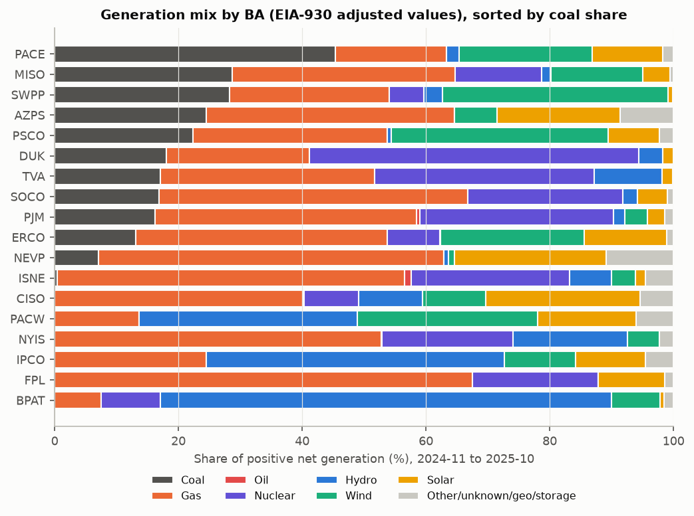

**Can we compute carbon intensity from the fuel mix? Yes, for every recommended BA.**
- The adjusted fuel columns sum to net generation within 0.7% over the validation year for all 18 candidates.
- No more than 3.2% of hours (SOCO) mismatch by more than 5%.
- "Other" plus "unknown" is under 2.5% of generation except NEVP (10.6%, mostly geothermal), PACW (6.1%), CISO (5.4%, mostly storage) and ISNE (4.5%).
- Across all BAs, the fuel mix is the weak spot only for small ones: IID (55% other/unknown), CPLW (26%) and GVL (24%).

**Method (modeled).**
- Hourly CI = Σ_f EF_f · max(G_f, 0) / Σ_f G_f, over the 13 partition fuels, using adjusted values.
- The denominator is signed, so storage charging lowers it.
- **Emission factors:** direct combustion, from EIA's FAQ "How much carbon dioxide is produced per kilowatthour of U.S. electricity generation?" (data year 2023, utility-scale including CHP).
  - Coal 2.31 lb/kWh = 1,048 g/kWh; gas 0.96 lb/kWh = 435 g/kWh; petroleum 2.46 lb/kWh = 1,116 g/kWh.
  - Nuclear, hydro, wind, solar, geothermal and storage are 0, as are biomass and "other" (EIA treats biomass as carbon neutral).
  - "Unknown" takes the all-source US average, 0.81 lb/kWh = 367 g/kWh (*assumed*).
- **Sensitivity:** with "other" at 367 g/kWh, PACE moves from 554 to 560 g/kWh, CISO from 189 to 210 and NEVP from 317 to 356.

**Cross-check against EIA's own hourly CO2 estimate** (per-BA workbooks, validation year; table in §8):
- Our mean is within ±5% of EIA's for 7 BAs (PACE −2%, ERCO, BPAT, MISO, SWPP, PSCO, PACW), and within ±6% for NEVP, NYIS and IPCO.
- It is 6–18% higher for gas-heavy BAs with efficient fleets (FPL +18%, CISO +13%, ISNE +10%, DUK +10%, PJM +8%, AZPS +8%, TVA +7%, SOCO +6%), because EIA uses BA-specific gas factors below the US average.
- Hourly correlation is at least 0.97 for 16 of 18 BAs.
- AZPS is the exception (0.76): EIA divides by *positive* generation, while we net out battery charging (AZPS batteries are 6.4%). The storage convention matters wherever batteries are large.

## 6. Rush-hour structure

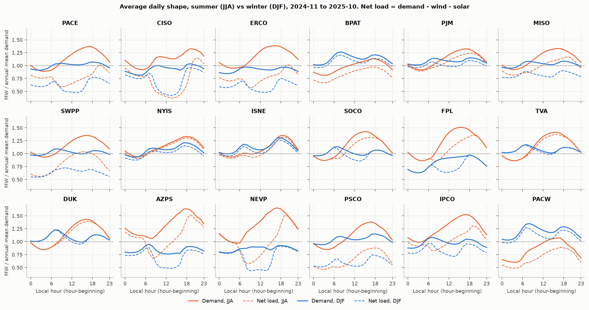

Validation-year average day, in local prevailing time with hour-beginning labels. D = demand, NL = net load = demand − wind − solar. Swing = max/min of the average day − 1.

| ba | summer peak hr (D) | summer peak hr (NL) | winter peak hr (D) | winter peak hr (NL) | summer daily swing D % | summer daily swing NL % | peak month | monthly swing % |
|---|---:|---:|---:|---:|---:|---:|---:|---:|
| PACE | 17 | 20 | 18 | 18 | 55 | 74 | 7 | 31 |
| CISO | 19 | 21 | 19 | 19 | 44 | 209 | 8 | 39 |
| BPAT | 17 | 17 | 8 | 8 | 39 | 46 | 1 | 29 |
| AZPS | 18 | 19 | 7 | 7 | 54 | 123 | 8 | 92 |
| NEVP | 17 | 19 | 18 | 18 | 70 | 162 | 8 | 67 |
| PSCO | 17 | 18 | 18 | 17 | 63 | 89 | 7 | 31 |
| ERCO | 16 | 20 | 8 | 18 | 46 | 81 | 8 | 42 |
| SWPP | 16 | 16 | 8 | 10 | 45 | 85 | 7 | 38 |
| MISO | 16 | 19 | 18 | 18 | 44 | 44 | 7 | 36 |
| PJM | 17 | 18 | 18 | 18 | 45 | 39 | 7 | 41 |
| IPCO | 17 | 19 | 7 | 6 | 54 | 59 | 7 | 65 |
| NYIS | 18 | 18 | 18 | 18 | 42 | 44 | 7 | 48 |

**When do the top hours fall, and how concentrated are they?** (Full years 2019–2024, cleaned demand.)

| ba | top-100 h in Jun-Sep % | in Dec-Feb % | modal hour (D) | modal hour (NL) | in 16:00-21:00 % | days holding them /yr | h within 5% of peak /yr | days within 5% | h within 10% | NL h within 5% | load factor % | h within 5%, range over years |
|---|---:|---:|---:|---:|---:|---:|---:|---:|---:|---:|---:|---|
| PACE | 100 | 0 | 17 | 19 | 76 | 27 | 34 | 12 | 155 | 11 | 63 | 21-40 |
| CISO | 99 | 0 | 18 | 19 | 80 | 24 | 24 | 8 | 70 | 9 | 55 | 7-40 |
| BPAT | 1 | 90 | 7 | 7 | 27 | 18 | 10 | 2 | 30 | 12 | 61 | 2-22 |
| AZPS | 99 | 0 | 17 | 18 | 76 | 27 | 12 | 6 | 50 | 12 | 46 | 1-33 |
| NEVP | 100 | 0 | 16 | 19 | 68 | 24 | 29 | 10 | 96 | 20 | 49 | 21-41 |
| PSCO | 100 | 0 | 17 | 17 | 64 | 26 | 14 | 5 | 80 | 10 | 56 | 10-33 |
| ERCO | 100 | 0 | 16 | 15 | 62 | 25 | 95 | 23 | 304 | 36 | 60 | 61-164 |
| SWPP | 99 | 1 | 16 | 16 | 61 | 20 | 43 | 11 | 158 | 12 | 61 | 28-59 |
| MISO | 100 | 0 | 16 | 16 | 53 | 19 | 28 | 6 | 107 | 34 | 63 | 15-56 |
| PJM | 98 | 1 | 17 | 17 | 59 | 19 | 34 | 8 | 120 | 36 | 61 | 12-62 |
| IPCO | 100 | 0 | 17 | 19 | 66 | 22 | 32 | 9 | 122 | 16 | 54 | 25-64 |
| NYIS | 100 | 0 | 17 | 17 | 56 | 16 | 26 | 6 | 84 | 30 | 57 | 12-51 |

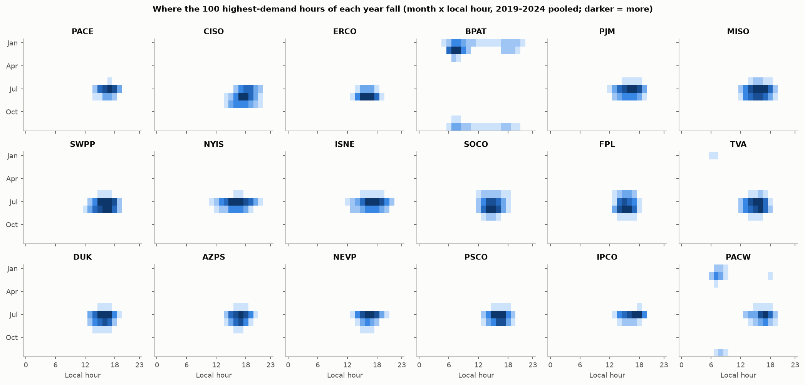
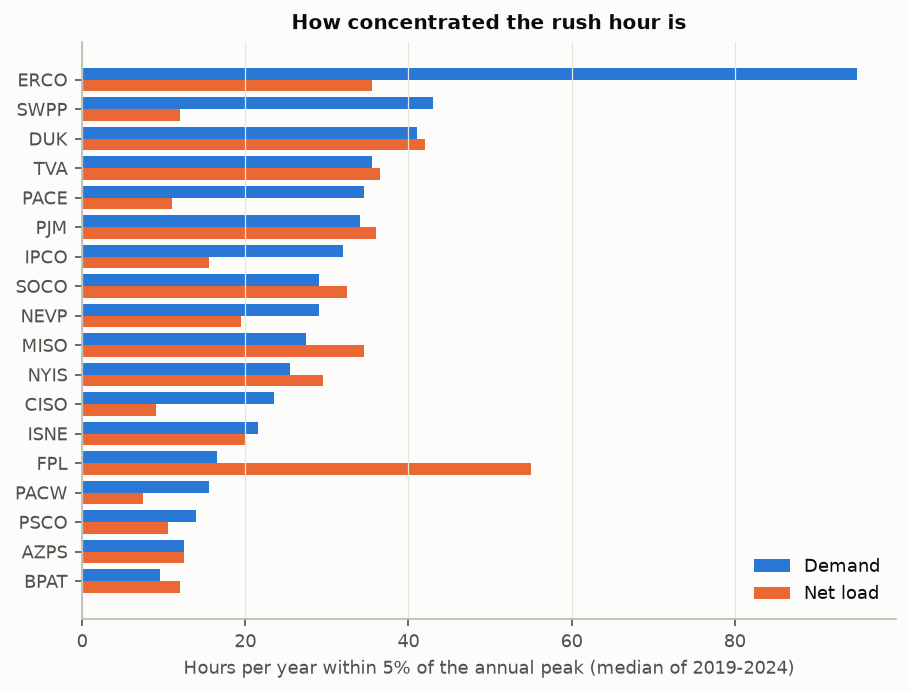

- **PACE.**
  - The summer peak is at 17:00 local; solar pushes the net-load peak to 20:00.
  - Within-day summer swing: demand 55%, net load 74%. Seasonal swing 31%; July peak.
  - The rush hour is a few dozen hours a year: 34 h within 5% of the peak (range 21–40 across 2019–2024), on 12 days; 155 h within 10%.
  - Net load is even more concentrated: 11 h within 5%.
  - The cleaned PACE peak for 2019–2024 is 9,562 MW.
- **Solar BAs shift the rush hour into the evening and deepen the midday trough.**
  - CISO's summer net load swings 209% in the average day; NEVP's 162%; AZPS's 123%.
  - In summer, the net-load peak comes 2–4 h after the demand peak in PACE, ERCO, MISO, CISO, IPCO and NEVP.
- **BPAT is the odd one out:** 90% of its top-100 hours fall in December–February, at 07:00. It peaks in winter, the opposite season to PACE.
- **ERCO's peak is the least concentrated:** 95 h/yr within 5% (61–164). A "top-k hours" rush-hour definition behaves very differently across BAs, so k should scale per BA, or the definition should use a percentile of the BA's own distribution.
- **Year-to-year variation is large** (PJM 12–62 h, CISO 7–40 h). Metrics on the top-k hours of a single test year will be noisy, so use bootstrap intervals.

## 7. The BA's own day-ahead forecast (the baseline)

**What DF is.** EIA-930 field DF:
- "Each BA produces a day-ahead electricity demand forecast for every hour of the next day."
- It reaches EIA in the daily file due at 7:00 a.m. ET, which carries "yesterday's hourly day-ahead demand forecast for today" (EIA-930 instructions).
- EIA publishes it "for each hour of today ... by 11:00 a.m. eastern time today" (About page).
- We confirmed this empirically: at retrieval (22:57 MDT), DF rows reached only 1 h past the retrieval time.
- The BA's actual issue time is unknown and BA-specific, but it is on D-1.

**Scoring rules used here.**
- DF is compared with *reported* demand.
- Hours are excluded where EIA imputed demand (996 of 1,181 imputed candidate hours equal the DF exactly), where demand is ≤ 0, and where demand is an isolated spike.

**Alignment check.**
- MAPE is computed with the DF shifted −2…+2 h against demand, per BA, year and DST season.
- **PJM:** +1 h is best in all 14 year × season cells, 2019–2025 (e.g. 2024 summer 3.8% at shift 0 vs 2.5% at +1).
- **CISO:** +1 h is best from summer 2022 on; shift 0 was best in 2020–21.
- **AZPS:** +1 h is marginally better only in 2024-W and 2025.
- **PACE and every other candidate:** shift 0 is best in every year and season.

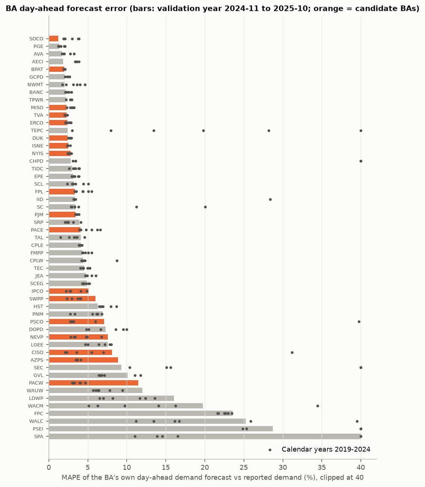

| ba | val h | val MAPE % | val MdAPE % | val bias % | best shift h | MAPE at best shift % | peak hour within 1 h (% days) | daily-peak MAPE % | 2019 | 2020 | 2021 | 2022 | 2023 | 2024 | 2025 |
|---|---:|---:|---:|---:|---:|---:|---:|---:|---:|---:|---:|---:|---:|---:|---:|
| PACE | 8760 | 4.0 | 3.3 | 2.7 | 0 | 4.0 | 70.6 | 3.7 | 3.9 | 6.6 | 5.5 | 6.2 | 4.8 | 4.1 | 4.2 |
| CISO | 8639 | 8.1 | 5.6 | -6.3 | 1 | 6.8 | 76.3 | 1.9 | 31.2 | 2.3 | 2.1 | 3.6 | 5.5 | 7.0 | 8.3 |
| BPAT | 8760 | 2.0 | 1.6 | 0.2 | 0 | 2.0 | 91.5 | 1.8 | 1.9 | 2.0 | 2.1 | 2.1 | 2.0 | 2.0 | 2.0 |
| AZPS | 8757 | 8.9 | 8.0 | -5.0 | 1 | 7.6 | 75.5 | 4.0 | 3.6 | 3.7 | 3.5 | 3.7 | 3.5 | 4.1 | 9.6 |
| NEVP | 8739 | 7.6 | 5.5 | -6.4 | 0 | 7.6 | 68.3 | 4.9 | 3.4 | 2.8 | 3.2 | 4.9 | 4.8 | 6.8 | 7.8 |
| PSCO | 8756 | 7.1 | 6.5 | -6.5 | 0 | 7.1 | 58.1 | 6.2 | 3.0 | 3.2 | 2.9 | 2.8 | 39.8 | 6.0 | 7.3 |
| ERCO | 8760 | 2.3 | 1.8 | 1.0 | 0 | 2.3 | 87.1 | 2.4 | 2.4 | 2.2 | 2.9 | 2.8 | 2.6 | 2.2 | 2.4 |
| SWPP | 8735 | 6.0 | 3.8 | 4.3 | 0 | 6.0 | 82.9 | 6.2 | 4.0 | 4.1 | 4.0 | 3.7 | 3.0 | 2.3 | 6.8 |
| MISO | 8737 | 2.3 | 2.0 | 1.8 | 0 | 2.3 | 90.9 | 2.2 | 3.2 | 3.2 | 2.3 | 3.0 | 3.0 | 2.8 | 2.3 |
| PJM | 8734 | 3.5 | 3.0 | -1.5 | 1 | 2.5 | 76.0 | 1.8 | 3.6 | 3.9 | 3.6 | 3.6 | 3.5 | 3.6 | 3.5 |
| IPCO | 8759 | 5.1 | 3.7 | 0.1 | 0 | 5.1 | 65.9 | 4.4 | 4.9 | 4.1 | 2.7 | 2.2 | 2.8 | 2.7 | 5.1 |
| NYIS | 8712 | 2.8 | 2.5 | -2.3 | 0 | 2.8 | 95.8 | 2.7 | 2.9 | 2.5 | 2.7 | 2.6 | 2.4 | 2.8 | 2.7 |
| ISNE | 8758 | 2.5 | 1.7 | -1.9 | 0 | 2.5 | 98.4 | 1.1 | 2.4 | 2.4 | 2.4 | 2.4 | 2.4 | 2.8 | 2.5 |
| SOCO | 8756 | 1.2 | 1.0 | -1.0 | 0 | 1.2 | 98.1 | 1.0 | 3.9 | 3.8 | 3.0 | 2.1 | 2.0 | 1.9 | 1.1 |
| FPL | 8733 | 3.3 | 2.8 | 0.9 | 0 | 3.3 | 80.4 | 2.9 | 4.4 | 4.3 | 5.1 | 3.5 | 5.5 | 3.3 | 3.3 |
| TVA | 8759 | 2.3 | 1.8 | 1.2 | 0 | 2.3 | 87.9 | 2.4 | 2.3 | 2.3 | 2.1 | 2.4 | 2.4 | 2.1 | 2.3 |
| DUK | 8760 | 2.4 | 1.9 | 0.4 | 0 | 2.4 | 90.1 | 2.8 | 2.7 | 2.8 | 2.8 | 2.9 | 2.5 | 2.9 | 2.5 |
| PACW | 8759 | 11.5 | 4.2 | 10.6 | 0 | 11.5 | 76.6 | 9.0 | 3.1 | 3.0 | 3.3 | 4.7 | 4.0 | 4.0 | 12.9 |

The year columns are calendar-year MAPE; 2025 covers January–October. Across all 53 BAs with a DF in the validation year, MAPE runs from 1.2% (SOCO) to 120% (SPA). EIA itself says DF comparisons are "not meaningful" for AVA, FPC, GVL, LGEE, PSEI, SEC, SPA and TEPC.

- **PACE's forecast is middling and biased high.**
  - MAPE 4.0%, median 3.3%, bias +2.7% (it over-forecasts).
  - It picks the day's peak hour within ±1 h on only 70.6% of days, against 87–98% for ERCO, MISO, NYIS, ISNE and SOCO.
  - The year-to-year range is 3.9–6.6%. There is room to beat it, especially on peak timing.
- **Broken or degraded years:**
  - CISO 2019 (31.2%), PSCO 2023 (39.8%; the winter cells are about 126%);
  - From 2024 to 2025: AZPS 4.1% to 9.6%, SWPP 2.3% to 6.8%, PACW 4.0% to 12.9%. NEVP has degraded steadily, from 2.8% in 2020 to 7.8%.
  - "Beating the BA" there is easy and must not become a headline without saying so.

## 8. Carbon intensity: room for *when* and *where*

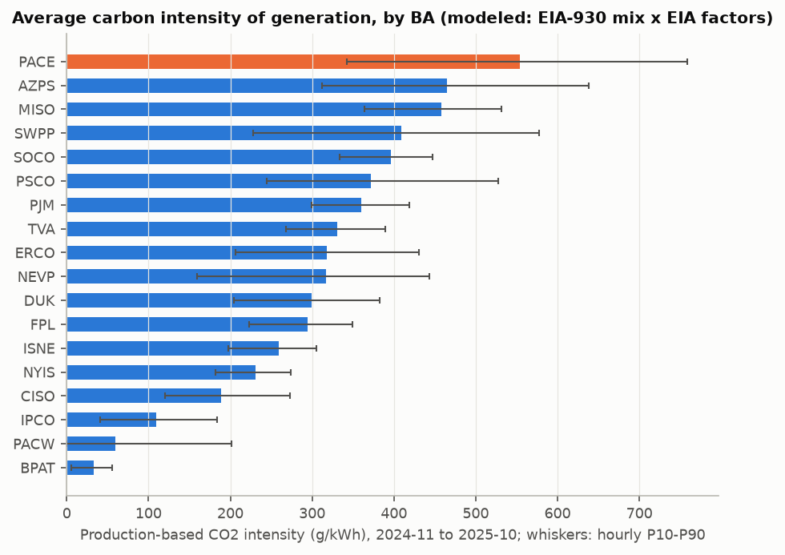
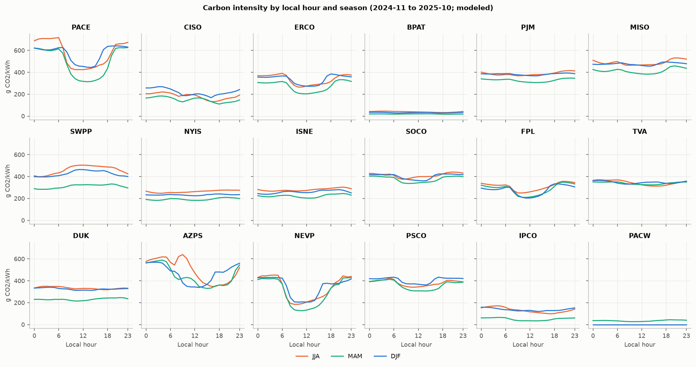
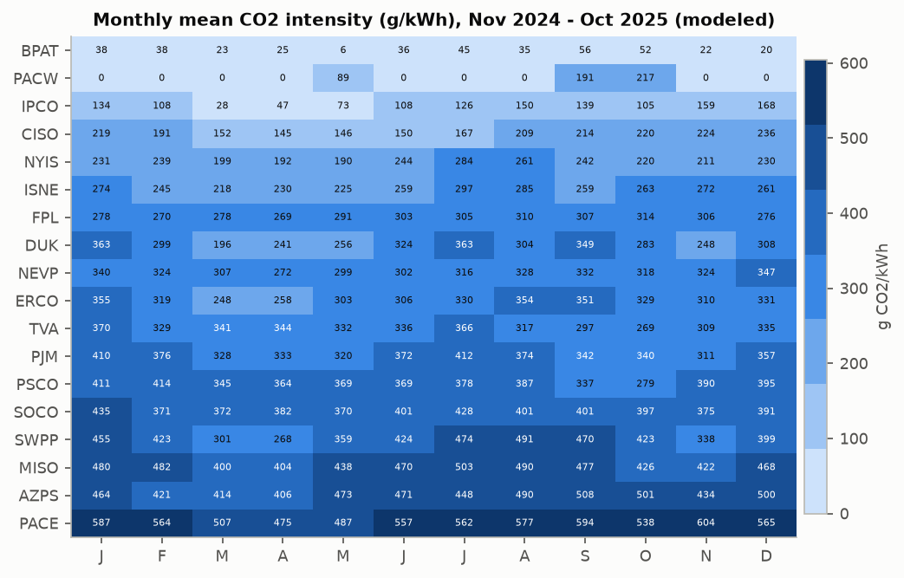

Validation year. "Ours" is modeled from fuel mix × EIA FAQ factors. "EIA gen" is EIA's estimated CO2 generated ÷ positive generation; "EIA consumed" is EIA's consumption-based intensity (both from the per-BA workbooks). "Wait ≤ W h cut" is the energy-weighted CO2 reduction for a 1-h job that may start any time in the next W h, with perfect foresight.

| ba | ours g/kWh | EIA gen g/kWh | EIA consumed g/kWh | hourly corr with EIA | P10 | P90 | daily range % of mean | best hour vs day mean % | wait <=6 h cut % | wait <=24 h cut % | cleanest month g/kWh | dirtiest month g/kWh | CI in top-100 demand h vs mean % | corr(demand, CI) |
|---|---:|---:|---:|---:|---:|---:|---:|---:|---:|---:|---:|---:|---:|---:|
| PACE | 554 | 566 | 564 | 1.00 | 343 | 759 | 64 | 32 | 15 | 33 | 475 | 604 | +3 | -0.18 |
| CISO | 189 | 166 | 186 | 0.97 | 120 | 273 | 60 | 29 | 15 | 30 | 145 | 236 | +27 | -0.02 |
| BPAT | 33 | 34 | 102 | 1.00 | 5 | 56 | 41 | 19 | 11 | 21 | 6 | 56 | +1 | -0.05 |
| AZPS | 465 | 432 | 329 | 0.76 | 312 | 638 | 71 | 33 | 17 | 34 | 406 | 508 | -7 | -0.03 |
| NEVP | 317 | 301 | 314 | 1.00 | 159 | 444 | 86 | 49 | 21 | 50 | 272 | 347 | +6 | -0.14 |
| PSCO | 371 | 384 | 390 | 1.00 | 244 | 527 | 58 | 26 | 13 | 27 | 279 | 414 | +6 | -0.12 |
| ERCO | 318 | 315 | 315 | 1.00 | 206 | 430 | 53 | 27 | 12 | 28 | 248 | 355 | +10 | +0.04 |
| SWPP | 409 | 425 | 416 | 1.00 | 228 | 578 | 42 | 22 | 9 | 21 | 268 | 491 | +23 | +0.36 |
| MISO | 458 | 451 | 441 | 1.00 | 364 | 531 | 22 | 11 | 5 | 11 | 400 | 503 | +11 | +0.42 |
| PJM | 360 | 334 | 329 | 1.00 | 300 | 419 | 15 | 7 | 4 | 8 | 311 | 412 | +20 | +0.74 |
| IPCO | 109 | 103 | 249 | 0.99 | 41 | 184 | 64 | 28 | 15 | 29 | 28 | 168 | +28 | +0.16 |
| NYIS | 231 | 245 | 257 | 1.00 | 182 | 274 | 19 | 9 | 5 | 10 | 190 | 284 | +36 | +0.75 |
| ISNE | 260 | 236 | 238 | 1.00 | 197 | 305 | 24 | 13 | 6 | 14 | 218 | 297 | +31 | +0.60 |
| SOCO | 396 | 372 | 365 | 0.99 | 334 | 447 | 22 | 12 | 5 | 12 | 370 | 435 | +10 | +0.34 |
| FPL | 294 | 249 | 264 | 1.00 | 223 | 349 | 44 | 25 | 11 | 25 | 269 | 314 | +7 | +0.09 |
| TVA | 330 | 308 | 322 | 0.98 | 268 | 389 | 19 | 9 | 4 | 9 | 269 | 370 | +15 | +0.16 |
| DUK | 300 | 274 | 274 | 0.97 | 205 | 382 | 25 | 12 | 6 | 13 | 196 | 363 | +27 | +0.54 |
| PACW | 59 | 59 | 128 | 1.00 | 0 | 201 | 70 | 29 | 16 | 33 | 0 | 217 | +17 | -0.06 |

**Time-shifting (when).**
- There are two families of BA.
  - Solar-driven BAs have a midday CI trough: a ≤ 24 h wait cuts 28–50% (NEVP 50%, AZPS 34%, PACE 33%, CISO 30%, ERCO 28%).
  - Nuclear- or gas-flat BAs barely move: PJM 8%, TVA 9%, NYIS 10%, MISO 11%.
- Most of the gain is available within 6 h. PACE gets 15% of its 33% with a ≤ 6 h wait.
- These are perfect-foresight upper bounds on average intensity. Marginal intensity can behave differently (see the open questions).
- **Rush hour and carbon are not the same signal.**
  - In NYIS, PJM, ISNE and DUK, demand and CI correlate at +0.54 to +0.75, and the top-100 demand hours are 20–36% dirtier than average.
  - In PACE the correlation is −0.18, and the top-100 demand hours are only 3% dirtier. Utah's summer afternoon peak coincides with solar output, while its dirtiest hours are at night (about 600–700 g/kWh, from coal).
  - A router that minimises carbon and one that avoids grid stress will move PACE jobs in different directions at night. The spec must pick, or weigh, the objective.

**Moving jobs between regions (where).** Validation-year hours where all 10 recommended BAs have a value (8,683 h):
- The mean hourly spread between the dirtiest and cleanest BA is 580 g/kWh.
- BPAT is the cleanest in 100% of hours. Excluding BPAT, CISO is cleanest in 72%, NEVP 15%, ERCO 6%, SWPP 3%, PSCO 3%.
- Against PACE (mean difference; share of hours the other BA is cleaner):

| BPAT | CISO | NEVP | ERCO | PJM | PSCO | SWPP | MISO | AZPS |
|---|---|---|---|---|---|---|---|---|
| −523 g/kWh; 100% | −364; 99.8% | −232; 98.7% | −239; 96.8% | −203; 89.4% | −181; 89.0% | −154; 76.1% | −103; 73.5% | −78; 71.5% |

- On production CI, moving a PACE job to BPAT cuts 94%. Even on EIA's consumption basis (BPAT 102 vs PACE 564 g/kWh) the cut is 82%.
- **PACE's neighbours.** Mean validation-year interchange out of PACE (`interchange.parquet`): IPCO +846 MW, NEVP +198 MW, LDWP +69 MW, AZPS +23 MW, NWMT −26 MW, WACM −354 MW.
- 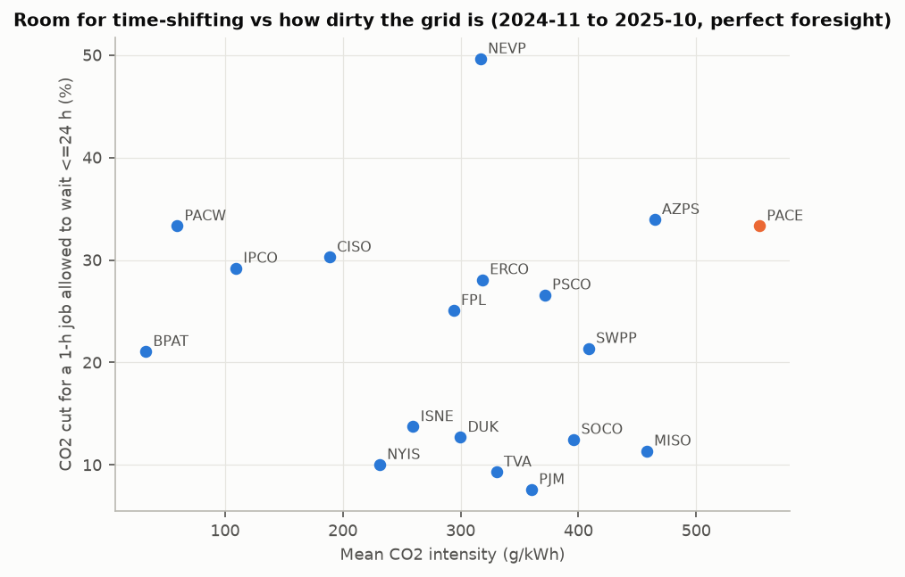
- 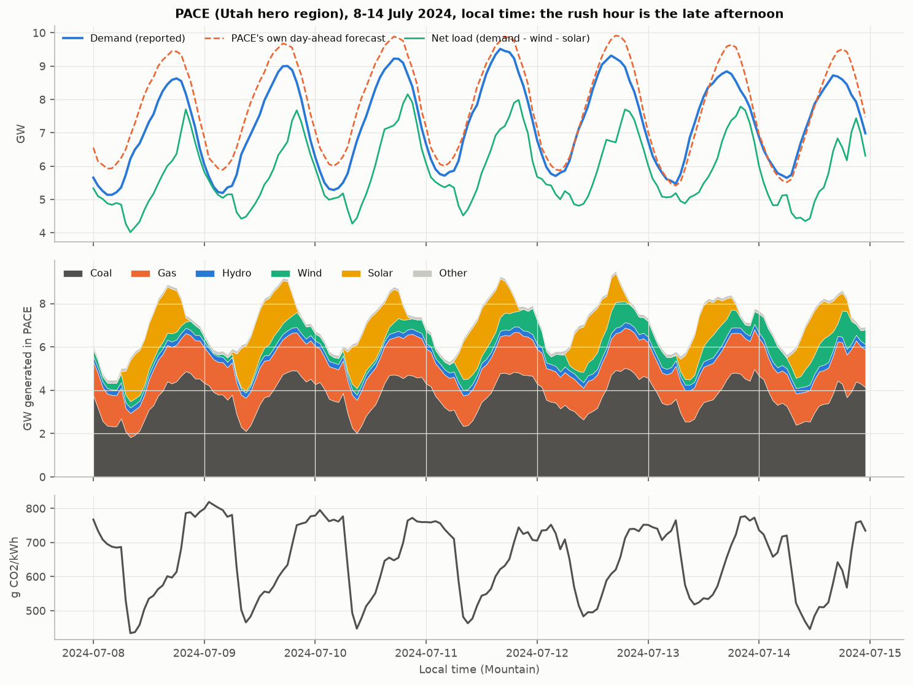

**Marginal intensity (sensitivity, modeled).**
- Method: the OLS slope of hourly ΔCO2 on Δnet load within each BA, over the validation year, using first differences (after Siler-Evans et al. 2012), in g/kWh.
- Δnet load explains the fossil response far better than Δtotal generation, which wind and solar ramps dilute. For PACE, R² is 0.47 against 0.15; for ERCO, 0.89 against 0.10.
- It is not identifiable (R² < 0.35) where imports, hydro or storage absorb the swings: CISO, BPAT, AZPS, NEVP, IPCO, PACW.

| ba | average g/kWh | marginal g/kWh | R² | 00–06 h | 06–12 h | 12–18 h | 18–24 h |
|---|---:|---:|---:|---:|---:|---:|---:|
| PACE | 554 | 618 | 0.47 | 497 | 658 | 498 | 550 |
| ERCO | 318 | 401 | 0.89 | 483 | 397 | 489 | 346 |
| PSCO | 371 | 384 | 0.68 | 381 | 397 | 418 | 376 |
| SWPP | 409 | 572 | 0.88 | 611 | 579 | 584 | 613 |
| MISO | 458 | 574 | 0.87 | 749 | 582 | 551 | 496 |
| PJM | 360 | 437 | 0.72 | 569 | 421 | 449 | 404 |
| NYIS | 231 | 328 | 0.73 | 410 | 350 | 342 | 310 |
| CISO | 189 | (12) | 0.01 | | | | |
| AZPS | 465 | (119) | 0.33 | | | | |
| NEVP | 317 | (235) | 0.13 | | | | |

- Hour blocks are local time. Values in parentheses are not identifiable.
- **In PACE, the marginal intensity barely follows the solar trough:** 498–658 g/kWh across the day, against an average that falls to about 320–450 at midday.
- Shifting a PACE job into the solar hours lowers the *average* intensity it is charged by up to 33%, but likely saves far less on the *margin*, unless solar is being curtailed. Sukprasert et al. (2024) make the same point.
- The router evaluation should report both. The marginal number is the honest one for a claim that emissions were "avoided".

## 9. Archived weather forecasts (Open-Meteo)

**Verdict: only the Previous Runs API with `_previous_day2` supports an honest day-ahead backtest.**
- With all three variables, that holds from **2024-02-17**; use **2024-03-01** as a clean start.
- With temperature alone, it holds from **2021-03-25**, with one gap from 2023-12-29T23Z to 2024-01-20T10Z (516 h).
- The Historical Forecast API is not honest for day-ahead. Neither is the unsuffixed Previous Runs output, which is identical to it.

| API / variable form | What the value at hour t is | Lead | Honest for an issue at 10:00 local on D−1? | Coverage at PACE_SLC (same dates at ERCO_DFW, CISO_LA, ISNE_BOS) |
|---|---|---|---|---|
| Historical Forecast, best_match | "Each run's first few hours are stitched into a continuous hourly timeseries" | 0–5 h | **No**: it is a nowcast | temperature and shortwave from 2018-01-01; 100 m wind from 2021-03-23 (HRRR-only, with no 100 m wind, before) |
| Previous Runs, unsuffixed | identical to Historical Forecast (100% of 40,417 overlapping hours) | 0–5 h | **No** | as above |
| Previous Runs `_previous_day1` | latest run initialised ≤ t − 24 h | 24–29 h | only for local hours 00–03 of D (at 6 h latency) | temperature 2021-03-24; shortwave 2024-01-19T12Z; wind 2024-02-16T06Z |
| Previous Runs `_previous_day2` | latest run initialised ≤ t − 48 h | 48–53 h | **Yes**, for every hour of D while latency ≤ 10 h | temperature 2021-03-25; shortwave 2024-01-20T12Z; wind 2024-02-17T06Z |

**Semantics.**
- Docs: "_previous_day1 returns the value predicted 24 hours before valid time ... up to day 7".
- Open-Meteo's launch post: "the initial 24 hours of each weather model run are disregarded ... for Previous Day 2, time steps 48, 49, and 50."
- The recon confirmed 6-hourly source runs in the 2024 data at Salt Lake City: the day-1 series jumps at 00, 06 and 12 UTC.

**Latency** (live model metadata tonight): GFS 5.4 h, ECMWF IFS 6.2–7.6 h, HRRR 1.5 h. The docs say "typically 4–6 hours for global models".

**No-lookahead rule.**
- `_previous_dayN` at label t is knowable at issue time I if t − 24N h ≤ I − latency.
- `gridpilot.data.weather.safe_previous_day` implements it. For PACE at 10:00 MT on D−1 it returns N = 1 for local hours 00–03 and N = 2 for the rest.

**Other models.**
- In the US, best_match is NCEP seamless (GFS + HRRR); `ncep_gfs_seamless` gives identical values.
- `ecmwf_ifs025` day 1/2 only starts 2024-02-04 to 2024-03-07.
- `ncep_hrrr_conus` has no day 2 and no 100 m wind.
- The Single Runs API, which serves exact runs, has data only from 2026-04-02, inside the sealed window.
- The docs warn that Historical Forecast is "not suitable for long time series due to model version changes over time".

**Downloads**, at the 17 primary load-centre points: every recommended BA plus IPCO, NYIS, ISNE, SOCO, FPL, TVA and DUK. Strictly sequential, about 1 s apart, no 429s. Units are °C, W/m² and m/s.

| Set | Variables | Range | Status (05:31Z) |
|---|---|---|---|
| Previous Runs P1 | temperature_2m, shortwave_radiation, wind_speed_100m × {day 0, day 1, day 2} | 2021-03-23 → 2026-10-26 | done: 102 files, 51 MB |
| Historical Forecast P1 | the same 3 variables | 2019-01-01 → 2026-10-26 | running in the background: 28 of 136 files (ETA about 06:35Z) |
| Previous Runs P2: 11 secondary load centres plus 8 wind/solar sites (e.g. PACE wind in Wyoming, PACE solar in Milford, UT) | 9 variables | 2024-01-01 → now | queued (ETA about 07:35Z) |

- **Seal:** the sealed window of Previous Runs P1 holds 146,863 rows (17 points × 8,639 hours) with 0 nulls in all 9 variables (completeness only).
- **Completeness before the seal:** from 2024-03 to 2025-10 there are 0 nulls across 248,880 rows × 9 variables.
- **Timestamps:** `weather.load()` sets `ts_utc` = Open-Meteo label − 1 h (hour start, as in EIA). shortwave_radiation is "averaged over the past hour", so after the shift it covers [ts_utc, ts_utc + 1 h). Temperature and wind are instants at the end of the hour.
- **License:** CC BY 4.0, attribution "Weather data by Open-Meteo.com". The free API is non-commercial.
- **Manifest:** `data/manifests/openmeteo.json` records, per file, the full-query URL, `retrieved_at`, bytes, sha256, API, model, point, dates and null counts.
- **Budget:** about 7,800 of the ~10,000 daily calls are used under the worst-case weighting.

**What this means for training.** With all three variables honest only from 2024-03, a strictly honest model has 8 months of training (2024-03 to 2024-10) before validation. The options are written out under "Implications".

## 10. Recommended BAs (10 core, 2 optional)

| # | BA | Why | Watch out for |
|---:|---|---|---|
| 1 | **PACE** (hero) | Utah. Complete data (demand 99.99%, DF 99.98%, 0 imbalance hours). 45% coal, so the dirtiest of the set (554 g/kWh) with a 33% ≤ 24 h shift cut. Narrow summer rush hour (34 h/yr within 5% of peak). BA forecast beatable (4.0% MAPE, +2.7% bias, peak hour within ±1 h on 71% of days) | 7 spikes; neighbour WACM changes code inside the test window |
| 2 | **CISO** | Solar-heavy duck curve (25% solar; summer net-load swing 209%). The cleanest big grid after hydro (189 g/kWh); cleanest non-BPAT BA 72% of hours. PacifiCorp (PACE) trades with it through CAISO's western market | DF +1 h misaligned since 2022 and 8.1% MAPE; D ≠ NG − TI in 43% of hours; storage hidden in "other" |
| 3 | **BPAT** | Hydro (73%), the cleanest destination (33 g/kWh generated, 102 consumed); winter-peaking (90% of top hours in Dec–Feb), the opposite of PACE; best-in-class DF (2.0%) | D ≠ NG − TI in 94% of hours (definition, not gaps); consumption vs production CI differs 3× |
| 4 | **NEVP** | Direct PACE neighbour (+198 MW from PACE); solar 25% plus geothermal; the largest time-shift room (50% at ≤ 24 h); Nevada data-center growth | DF degrading (7.6%, bias −6.4%); geothermal hidden in "other" |
| 5 | **AZPS** | Direct PACE neighbour; desert solar (20%) plus batteries (6.4%) plus coal (25%); Phoenix data-center hub; an AZPS peak is the most extreme (load factor 46%) | DF degraded in 2025 (8.9%); 23 spikes; storage convention changes CI (hourly corr with EIA 0.76) |
| 6 | **PSCO** | Rocky Mountain peer of Utah; wind-heavy (35%) plus coal (22%); CI swings 244–527 g/kWh (P10–P90) | DF broken in winter 2023 and 7.1% in validation |
| 7 | **ERCO** | Texas, 55 GW, wind (23%) plus solar (13%); the cleanest data in the set (0 imputed, 0 spikes, 0 imbalance; DF 2.3%, aligned); a broad peak (95 h within 5%) contrasts with PACE's narrow one | Isolated grid: jobs can move there, power cannot |
| 8 | **SWPP** | Wind-heavy (36.5%), the widest CI spread among large grids (P10–P90 of 228–578 g/kWh) | 1,941 flat-line hours; DF degraded in summer 2025 (6.0% val); 480 DF hours missing in the test window |
| 9 | **MISO** | Midwest, 74 GW, coal (29%) plus wind (15%); clean DF (2.3%); an example of a flat CI (11% shift room) | Publishes EST all year (handled; local clock uses America/Chicago) |
| 10 | **PJM** | The largest grid (91 GW mean); Northern Virginia data-center alley; nuclear 31%; the flattest CI (8% shift room), showing where time-shifting does not pay | DF published 1 h early (align +1 h: 3.5% to 2.5% MAPE); 7 absurd raw values (use adjusted) |
| opt | **IPCO** | PACE's largest trading partner (+846 MW); hydro 48%; the clearest case for consumption-based CI (249 consumed vs 103 generated) | Time zone listed as Pacific by EIA; DF 5.1% in 2025 |
| opt | **NYIS** | Clean data (0 imputed, 0 spikes, DF 2.8%); an East Coast reference where the rush hour is also the dirtiest time (+36%) | Little time-shift room (10%) |

Not recommended:
- **PACW**: PacifiCorp's other half, but its DF degraded to 11.5%. It reports zero gas generation in every month from November to April of the validation year, but 190–560 MW in May, September and October, so its fuel mix looks unreliable. Its mean generation is only 698 MW.
- **FPL**: a 6.3% demand gap in 2022.
- **TVA, DUK, SOCO, ISNE**: good data, but flat CI (9–14% shift room) duplicates PJM and MISO.
- **PSEI, SPA, FPC, WALC, WACM, LDWP**: DF MAPE 16–120%, or demand gaps.

## Implications for the experiment design

- **Time base.** Use hour-beginning UTC `ts_utc` everywhere. Convert to local time only for calendar features and display. MISO's published local time is EST all year; take local time from an IANA zone per BA, not from EIA's local column.
- **Target.**
  - Forecast `demand_adj_mw` with isolated spikes and values ≤ 0 removed (spike rule in §4).
  - Score only hours where demand was *not* imputed. Imputed hours often equal the BA's DF, so scoring on them flatters that baseline and pollutes ours.
  - Report how many hours each cleaning rule removed. Here: 0–28 spike hours and 0–147 imputed hours per recommended BA over 6.8 years.
- **The BA's DF is a baseline, never a feature,** for any issue time on D-1: it is published around 11:00 ET on day D.
  - Align it before scoring: PJM +1 h for all years; CISO +1 h from mid-2022. Otherwise report it as published and say so.
  - Pre-register the per-BA alignment from the validation year, never from the test year.
- **Choose the issue time with the publication lags in mind.**
  - At 10:00 MT on D-1, the freshest observed data is: demand through the previous hour; fuel mix and interchange through the end of D-2 (published by 11:00 ET on D-1, i.e. 09:00 MT); EIA's CO2 only through D-3 (published 16:00 ET).
  - Lagged-generation features need a lag of at least 1.5 days.
- **Rush-hour definitions should be per BA and percentile-based.**
  - The number of hours near the peak differs nearly 3× between BAs (PACE 34 h vs ERCO 95 h within 5%), and it varies a lot from year to year (PACE 21–40, PJM 12–62).
  - Rush-hour precision and recall on one test year need bootstrap intervals.
  - Net load is more concentrated than demand (PACE 11 h vs 34 h within 5%), and its peak is later (20:00 vs 17:00). The traffic report should forecast both.
- **Carbon.**
  - Use EIA's own hourly CO2 estimate (per-BA workbooks, *modeled by EIA*) as the primary average-CI signal, both production and consumption basis.
  - Use our fuel-mix CI as the transparent fallback and as the input for marginal-CI regressions. It matches EIA within ±5% for 7 of 18 BAs (±6% for 10) and has hourly correlation ≥ 0.97 for 16.
  - State the storage convention: EIA divides by positive generation.
  - For router savings, report consumption-based numbers next to production-based ones. They differ by 2–3× for BPAT, IPCO and PACW.
- **The router's headline will likely be "where" more than "when".**
  - For PACE, a ≤ 24 h shift cuts at most 33% of average CI, but moving to NEVP, CISO or BPAT cuts 42%, 66% and 94% on average.
  - The spec should model a migration cost or a capacity limit at destinations, or "go to BPAT" becomes a trivial optimum.
- **Average vs marginal.** Time-shifting gains in PACE are large on average CI (33%) but small on marginal CI (498–658 g/kWh across the day; §8). Pre-register both, and do not headline an average-CI saving as avoided emissions.
- **Emissions-first changes what "rush hour" means in Utah.** The owner approved emissions-first scheduling (AGENTS.md).
  - In PACE, demand and CI correlate at −0.18, and the top-100 demand hours are only 3% dirtier than average.
  - So an emissions-first PACE router will mostly move work out of the **night** (coal, about 600–700 g/kWh) into the **midday** solar trough, not out of the 17:00–20:00 demand peak.
  - Rush-hour avoidance comes with carbon only where the peak is dirtier: NYIS +36%, ISNE +31%, CISO and DUK +27%, SWPP +23%, PJM +20%.
  - Report grid-stress hours avoided as a secondary outcome, not as the objective.
- **Structural breaks.**
  - The 2024-07 fuel-taxonomy change: harmonized columns are provided.
  - BAs whose DF degrades in 2025 (AZPS, NEVP, SWPP, PACW).
  - The 2026-04 WACM/WAUW → SWPW change inside the test window (completeness only). Use train data from 2022 on for models that depend on recent behaviour; keep 2019 on for long seasonal statistics.
- **Weather features and the train start** (§9). Honest day-ahead weather (`_previous_day2`) exists for all three variables only from 2024-03-01. The spec must choose:
  - **(a) Strict:** train on `_previous_day2` features from 2024-03 to 2024-10 (8 months).
  - **(b) Temperature-honest:** train on `_previous_day2` temperature from 2021-03-25, about 3.5 years, with the 2023-12-29 to 2024-01-20 gap. Add shortwave and wind from 2024-03, or leave them out.
  - **(c) Skewed training:** train on Historical Forecast (0–5 h lead) features for 2019 to 2024-02, then validate and test only on `_previous_day2`.
    - Evaluation stays honest, because every validation and test input is knowable at issue time.
    - But the model learns on better weather than it will get. Measure that skew on validation by scoring the same model with both feature sources.
  - Whatever the choice: weather features at validation and test must come from `weather.safe_previous_day`, never from unsuffixed or Historical Forecast values.

## Open questions

1. **Which series carries PJM's 1-h offset**, the DF or demand? EIA-930 alone cannot tell. A weather–demand lag check (temperature peak vs demand peak) on the archived forecasts could. The same question applies to CISO since 2022.
2. **Why did CISO's DF error grow from about 2% (2020–21) to 8% (2025)** while shifting by 1 h? Did CAISO's DF definition change, for example the WEIM area or storage accounting? The answer decides whether CISO's DF is a fair baseline.
3. **Are the 2025 DF degradations at AZPS, NEVP, SWPP and PACW real forecast deterioration or reporting changes?** The test window will show whether they persist. Only the spec may decide how to treat that.
4. **Marginal vs average carbon.**
   - A ΔCO2/Δnet-load regression identifies a marginal factor for 12 of 18 BAs, PACE included (618 g/kWh, R² 0.47).
   - It does not for CISO, BPAT, AZPS, NEVP, IPCO and PACW, because imports, hydro and storage absorb the swings.
   - Should the router's primary objective be average CI (EIA), with the marginal regression as a sensitivity, or the reverse?
   - What should the router use where marginal intensity is not identifiable?
5. **Consumption- or production-based CI for the router?** It changes BPAT from 34 to 102 g/kWh and IPCO from 103 to 249. Consumption-based is what a data center would claim; production-based is what the BA emits.
6. **SWPP's 1,941 flat-line hours.** Are they stale telemetry, to be dropped, or true constant values? They span 2019-03 to 2025-10.
7. **Energy-balance failures** (BPAT 94%, CISO 43% of hours): do they matter for features built from NG and TI? They do not affect demand forecasting, but they do affect any flow-tracing carbon of our own.
8. **Local time for multi-zone BAs** (MISO, SWPP, PJM): one IANA zone per BA, or features in UTC only?
9. **Weather points.**
   - Downloaded so far: one load-centre point per BA.
   - Large multi-climate BAs (CISO, ERCO, PJM, MISO) probably need population-weighted points. Net-load forecasting needs the wind and solar sites, because PACE's wind is in Wyoming and its solar in southern Utah, not at Salt Lake City.
   - Those 19 P2 points are queued, Previous Runs only and from 2024-01. Is that enough, or does the spec want them back to 2021 (temperature-only honesty there anyway)?

## Appendix A: all BAs (2019-01 to 2025-10)

Coverage is the share of expected hours (2019-01-01 to 2025-10-31) with a value. The DF and CI columns cover the validation year; DF MAPE is shown only for BAs with more than 1,000 scored hours, and CI only for BAs averaging more than 300 MW of generation. Generation-only BAs have no demand. "first" and "last" are the first and last hours with demand or generation.

| ba | region | first | last | mean demand MW | demand reported % | DF reported % | fuel mix % | other+unknown % of gen | val DF MAPE % | DF best shift h | val CI g/kWh | wait <=24 h cut % |
|---|---|---|---|---:|---:|---:|---:|---:|---:|---:|---:|---:|
| BANC | CAL | 2019-01-01 | 2025-10-31 | 1,988 | 100.0 | 99.5 | 100.0 | 0.9 | 2.2 | +0 | 233 | 19 |
| CISO | CAL | 2019-01-01 | 2025-10-31 | 25,130 | 99.8 | 99.9 | 99.9 | 2.2 | 8.1 | +1 | 189 | 30 |
| IID | CAL | 2019-01-01 | 2025-10-31 | 436 | 99.8 | 99.4 | 100.0 | 55.4 | 3.3 | +0 | 81 | 38 |
| LDWP | CAL | 2019-01-01 | 2025-10-31 | 2,869 | 99.7 | 99.4 | 99.9 | 7.9 | 16.0 | -1 | 364 | 39 |
| TIDC | CAL | 2019-01-01 | 2025-10-31 | 327 | 99.8 | 99.8 | 100.0 | 0.0 | 3.0 | +0 |  |  |
| CPLE | CAR | 2019-01-01 | 2025-10-31 | 6,980 | 99.9 | 99.9 | 100.0 | 12.2 | 4.1 | +0 | 225 | 30 |
| CPLW | CAR | 2019-01-01 | 2025-10-31 | 563 | 99.9 | 99.9 | 100.0 | 26.4 | 4.4 | +0 | 285 | 10 |
| DUK | CAR | 2019-01-01 | 2025-10-31 | 12,101 | 100.0 | 99.9 | 100.0 | 0.1 | 2.4 | +0 | 300 | 13 |
| SC | CAR | 2019-01-01 | 2025-10-31 | 2,845 | 99.8 | 99.7 | 100.0 | 3.2 | 3.5 | -1 | 812 | 9 |
| SCEG | CAR | 2019-01-01 | 2025-10-31 | 2,793 | 99.7 | 99.0 | 99.9 | 0.0 | 4.9 | +0 | 370 | 20 |
| YAD | CAR | 2019-01-01 | 2025-10-31 |  | 0.0 | 0.0 | 100.0 | 0.0 |  |  |  |  |
| SPA | CENT | 2019-01-01 | 2025-10-31 | 53 | 99.7 | 97.6 | 99.7 | 16.6 | 117.2 | +0 | 0 | nan |
| SWPP | CENT | 2019-01-01 | 2025-10-31 | 31,775 | 100.0 | 99.8 | 100.0 | 0.1 | 6.0 | +0 | 409 | 21 |
| FMPP | FLA | 2019-01-01 | 2025-10-31 | 2,125 | 99.7 | 99.3 | 100.0 | 0.9 | 4.3 | +0 | 520 | 12 |
| FPC | FLA | 2019-01-01 | 2025-10-31 | 6,442 | 100.0 | 99.9 | 100.0 | 1.6 | 23.5 | +2 | 437 | 21 |
| FPL | FLA | 2019-01-01 | 2025-10-31 | 15,691 | 98.7 | 99.7 | 99.1 | 8.9 | 3.3 | +0 | 294 | 25 |
| GVL | FLA | 2019-01-01 | 2025-10-31 | 238 | 97.9 | 98.1 | 98.7 | 24.0 | 10.1 | +0 |  |  |
| HST | FLA | 2019-01-01 | 2025-10-31 | 71 | 99.9 | 99.5 | 100.0 | 0.0 | 6.3 | +0 |  |  |
| JEA | FLA | 2019-01-01 | 2025-10-31 | 1,523 | 99.6 | 94.7 | 100.0 | 0.3 | 4.8 | +0 | 626 | 7 |
| NSB | FLA | 2019-01-01 | 2020-01-08 | 51 | 48.1 | 48.0 | 49.5 | nan |  |  |  |  |
| SEC | FLA | 2019-01-01 | 2025-10-31 | 220 | 99.4 | 99.6 | 100.0 | 0.0 | 9.3 | +0 | 541 | 8 |
| TAL | FLA | 2019-01-01 | 2025-10-31 | 321 | 98.8 | 100.0 | 98.8 | 0.0 | 4.1 | +0 | 421 | 9 |
| TEC | FLA | 2019-01-01 | 2025-10-31 | 2,524 | 99.9 | 99.9 | 99.6 | 11.5 | 4.6 | +0 | 378 | 26 |
| PJM | MIDA | 2019-01-01 | 2025-10-31 | 91,448 | 99.8 | 99.7 | 100.0 | 1.3 | 3.5 | +1 | 360 | 8 |
| AECI | MIDW | 2019-01-01 | 2025-10-31 | 2,666 | 100.0 | 100.0 | 100.0 | 0.0 | 1.8 | +0 | 725 | 12 |
| EEI | MIDW | 2019-01-01 | 2020-02-29 |  | 0.0 | 0.0 | 56.9 | 0.0 |  |  |  |  |
| GLHB | MIDW | 2020-02-29 | 2022-09-01 |  | 0.0 | 0.0 | 83.5 | 0.0 |  |  |  |  |
| LGEE | MIDW | 2019-01-01 | 2025-10-31 | 4,119 | 99.7 | 99.9 | 99.9 | 0.0 | 7.6 | +0 | 911 | 3 |
| MISO | MIDW | 2019-01-01 | 2025-10-31 | 73,671 | 99.9 | 99.9 | 100.0 | 0.9 | 2.3 | +0 | 458 | 11 |
| SIKE | MIDW | 2025-06-02 | 2025-10-31 |  | 0.0 | 0.0 | 49.7 | 0.0 |  |  |  |  |
| ISNE | NE | 2019-01-01 | 2025-10-31 | 13,175 | 100.0 | 100.0 | 100.0 | 5.3 | 2.5 | +0 | 260 | 14 |
| AVA | NW | 2019-01-01 | 2025-10-31 | 1,461 | 100.0 | 100.0 | 100.0 | 10.9 | 1.7 | +0 | 138 | 25 |
| AVRN | NW | 2019-01-01 | 2025-10-31 |  | 0.0 | 0.0 | 100.0 | 0.0 |  |  | 165 | 38 |
| BPAT | NW | 2019-01-01 | 2025-10-31 | 6,544 | 100.0 | 100.0 | 100.0 | 1.8 | 2.0 | +0 | 33 | 21 |
| CHPD | NW | 2019-01-01 | 2025-10-31 | 217 | 99.9 | 99.9 | 100.0 | 0.0 | 2.8 | +0 | 0 | nan |
| DOPD | NW | 2019-01-01 | 2025-10-31 | 239 | 97.6 | 99.3 | 99.1 | 0.0 | 7.3 | +0 | 0 | nan |
| GCPD | NW | 2019-01-01 | 2025-10-31 | 688 | 100.0 | 100.0 | 100.0 | 0.0 | 2.0 | +0 | 0 | nan |
| GRID | NW | 2019-01-01 | 2025-10-31 |  | 0.0 | 0.0 | 100.0 | 0.0 |  |  | 491 | 12 |
| GWA | NW | 2019-01-01 | 2025-10-31 |  | 0.0 | 0.0 | 100.0 | 0.0 |  |  |  |  |
| IPCO | NW | 2019-01-01 | 2025-10-31 | 2,080 | 100.0 | 100.0 | 100.0 | 3.0 | 5.1 | +0 | 109 | 29 |
| NEVP | NW | 2019-01-01 | 2025-10-31 | 4,461 | 100.0 | 99.9 | 100.0 | 11.1 | 7.6 | +0 | 317 | 50 |
| NWMT | NW | 2019-01-01 | 2025-10-31 | 1,360 | 99.9 | 99.1 | 100.0 | 0.0 | 2.0 | +0 | 577 | 17 |
| PACE | NW | 2019-01-01 | 2025-10-31 | 5,751 | 100.0 | 100.0 | 100.0 | 1.9 | 4.0 | +0 | 554 | 33 |
| PACW | NW | 2019-01-01 | 2025-10-31 | 2,388 | 100.0 | 100.0 | 100.0 | 3.7 | 11.5 | +0 | 59 | 33 |
| PGE | NW | 2019-01-01 | 2025-10-31 | 2,500 | 99.9 | 100.0 | 100.0 | 0.9 | 1.4 | +0 | 334 | 27 |
| PSCO | NW | 2019-01-01 | 2025-10-31 | 5,284 | 99.9 | 98.6 | 100.0 | 0.5 | 7.1 | +0 | 371 | 27 |
| PSEI | NW | 2019-01-01 | 2025-10-31 | 2,914 | 84.6 | 100.0 | 100.0 | 2.0 | 28.7 | -2 | 274 | 18 |
| SCL | NW | 2019-01-01 | 2025-10-31 | 1,075 | 100.0 | 99.5 | 100.0 | 0.0 | 3.2 | +0 | 0 | nan |
| TPWR | NW | 2019-01-01 | 2025-10-31 | 544 | 100.0 | 100.0 | 100.0 | 0.0 | 2.2 | +0 |  |  |
| WACM | NW | 2019-01-01 | 2025-10-31 | 3,083 | 100.0 | 99.5 | 99.9 | 0.0 | 19.8 | -2 | 645 | 13 |
| WAUW | NW | 2019-01-01 | 2025-10-31 | 95 | 100.0 | 100.0 | 100.0 | 0.0 | 12.0 | +0 |  |  |
| WWA | NW | 2019-01-01 | 2025-10-01 |  | 0.0 | 0.0 | 98.8 | 0.0 |  |  |  |  |
| NYIS | NY | 2019-01-01 | 2025-10-31 | 17,271 | 100.0 | 99.7 | 100.0 | 2.8 | 2.8 | +0 | 231 | 10 |
| AEC | SE | 2019-01-01 | 2021-09-01 | 538 | 88.5 | 88.3 | 88.9 | 0.7 |  |  |  |  |
| SEPA | SE | 2019-01-01 | 2025-10-31 |  | 0.0 | 0.0 | 100.0 | 0.0 |  |  | 0 | nan |
| SOCO | SE | 2019-01-01 | 2025-10-31 | 26,910 | 99.9 | 99.9 | 100.0 | 1.0 | 1.2 | +0 | 396 | 12 |
| AZPS | SW | 2019-01-01 | 2025-10-31 | 3,771 | 99.9 | 99.5 | 100.0 | 1.5 | 8.9 | +1 | 465 | 34 |
| DEAA | SW | 2019-01-01 | 2025-10-31 |  | 0.0 | 0.0 | 100.0 | 0.0 |  |  | 435 | 0 |
| EPE | SW | 2019-01-01 | 2025-10-31 | 1,019 | 100.0 | 100.0 | 100.0 | 0.0 | 3.2 | +0 | 375 | 27 |
| GRIF | SW | 2019-01-01 | 2023-11-01 |  | 0.0 | 0.0 | 96.7 | 0.0 |  |  |  |  |
| HGMA | SW | 2019-01-01 | 2025-06-01 |  | 0.0 | 0.0 | 93.9 | 0.0 |  |  | 435 | 0 |
| PNM | SW | 2019-01-01 | 2025-10-31 | 1,631 | 100.0 | 99.9 | 100.0 | 0.7 | 6.9 | +0 | 178 | 55 |
| SRP | SW | 2019-01-01 | 2025-10-31 | 3,804 | 99.6 | 91.4 | 100.0 | 0.2 | 3.9 | +0 | 215 | 27 |
| TEPC | SW | 2019-01-01 | 2025-10-31 | 1,573 | 98.4 | 99.7 | 99.2 | 0.1 | 2.4 | +0 | 497 | 20 |
| WALC | SW | 2019-01-01 | 2025-10-31 | 1,060 | 99.9 | 99.9 | 100.0 | 0.0 | 25.3 | -1 | 187 | 30 |
| TVA | TEN | 2019-01-01 | 2025-10-31 | 18,438 | 100.0 | 99.9 | 100.0 | 0.2 | 2.3 | +0 | 330 | 9 |
| ERCO | TEX | 2019-01-01 | 2025-10-31 | 48,631 | 100.0 | 100.0 | 100.0 | 0.3 | 2.3 | +0 | 318 | 28 |
