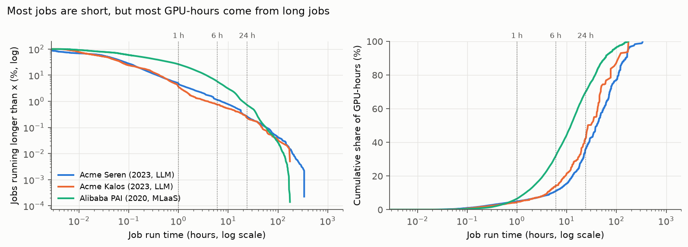
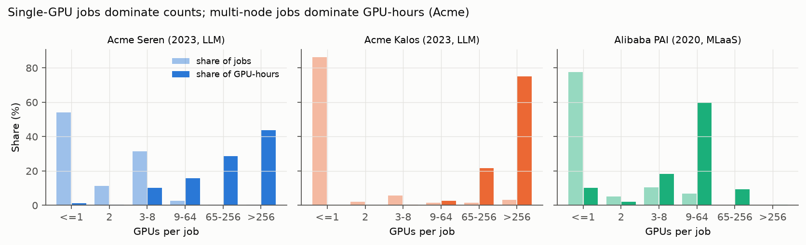
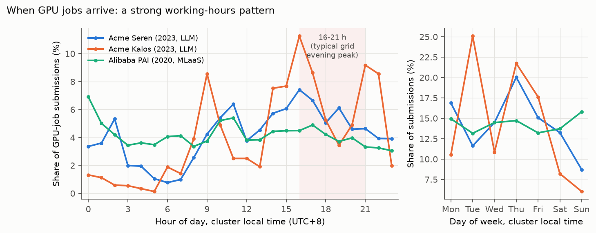
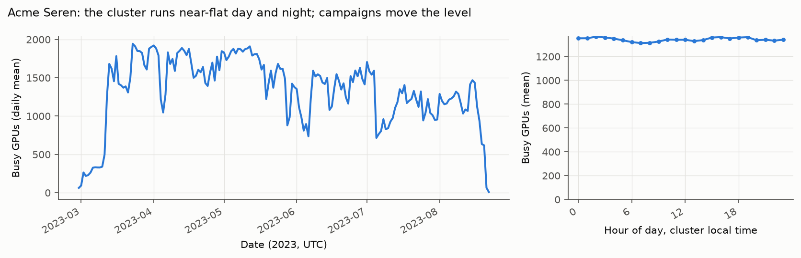
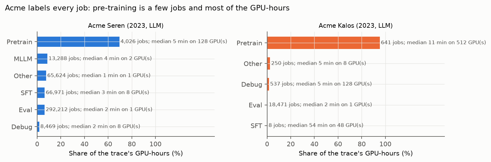
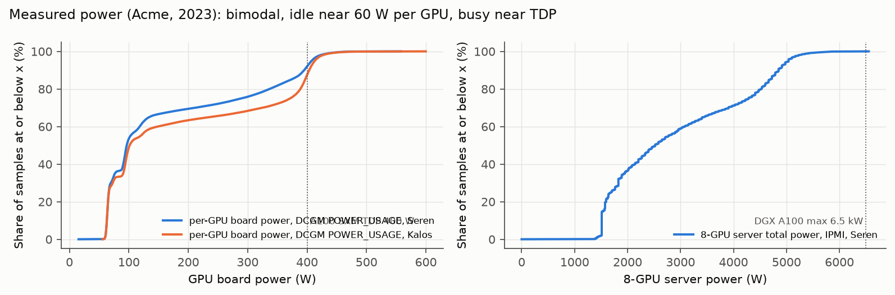
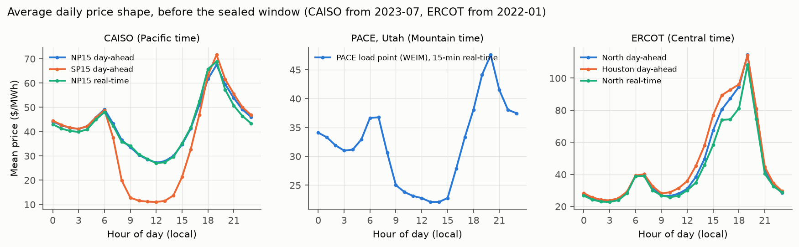
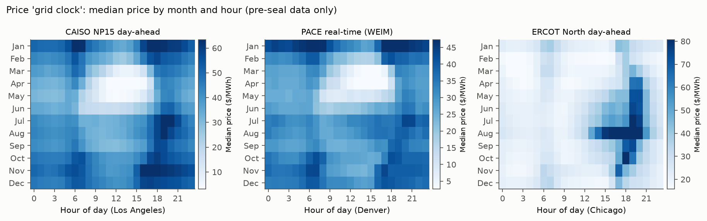
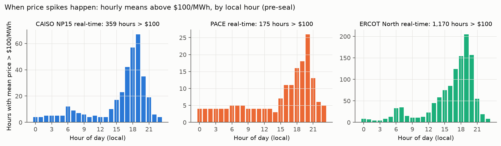
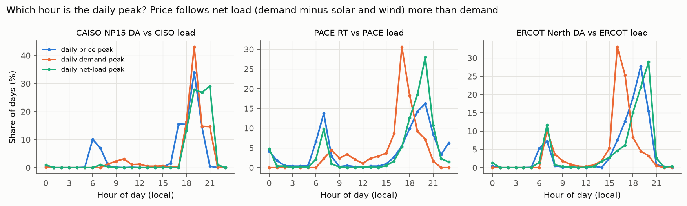

# Data profile: AI workloads and wholesale prices

Recon for the experiment design, 2026-10-26/27 (MDT). Facts only; the design decisions are in the spec. Every number below comes from a script in `lab/scripts/` and the raw files recorded in `data/manifests/`.

- **Seal.** Price statistics and figures use only data before 2025-11-01T00:00Z (`gridpilot.splits.drop_sealed`). For the sealed window [2025-11-01Z, 2026-11-01Z), this doc reports completeness only: rows and missing hours.
- **Traces.** The workload traces (2020–2023, plus one 2026 release) are not sealed, and nothing here joins them to grid or price values.
- **Labels** (AGENTS.md): trace fields are `measured`, prices and demand are `observed`, and energy per GPU-hour is `modeled` from `measured` power and `assumed` PUE.
- **Reproduce:**

```
cd lab
uv run python scripts/recon_traces_download.py          # traces -> data/raw/traces/
uv run python scripts/recon_prices_download.py ercot caiso
uv run python scripts/recon_prices_probe.py             # node discovery, one day each
uv run python scripts/recon_traces_profile.py --stats <out.json>
uv run python scripts/recon_prices_profile.py --stats <out.json>
```

## 1. Workload traces

### 1.1 Candidates

| Trace | License or terms | Size | Period | Jobs | Fields that matter here | Download |
|---|---|---|---|---|---|---|
| **Acme** (Shanghai AI Lab, NSDI '24), clusters Seren and Kalos | CC-BY-4.0 | job tables 108 MB on GitHub; DCGM/IPMI telemetry ~80 GB on HuggingFace | Seren 2023-03-01 to 08-16; Kalos 2023-05-17 to 08-16 | 880,740 (470,497 GPU) | submit, start, end, queue, run time; GPU, CPU and node count; **job type** (Pretrain, SFT, MLLM, Eval, Debug, Other, CPU); final state, including PREEMPTED; A100 nodes; processed power and utilization CDFs | easy |
| **Alibaba PAI 2020** (`cluster-trace-gpu-v2020`, NSDI '22) | CC-BY-4.0 | 1.4 GB compressed (7 tables) | Jul–Aug 2020. Dates are faked, but time of day and day of week are true (UTC+8) | 1,055,501 job rows (1,017,904 request GPUs) | submit time, task start and end, status; GPU request (fractional); GPU type (T4, P100, V100, V100M32, MISC); task role; semantic workload tag (about 9%); recurring-group tag; per-instance GPU utilization | easy; sha256 published |
| Microsoft Philly (ATC '19) | CC-BY-4.0 | 0.98 GB compressed (Git LFS), 6.6 GB unpacked, mostly per-minute GPU utilization | 2017-08-07 to 2017-12-22 | 117,325 | submit time; attempts with start, end, machines and GPUs; status Pass, Killed or Failed; no job type or GPU model | feasible, but LFS and the oldest |
| SenseTime Helios (SC '21) | CC-BY-4.0 | 36 MB zip (343 MB of CSV) | 2020-04 to 2020-09 | 3,362,981 (1,580,464 GPU) | submit, start, end, queue; GPU, CPU and node count; state; VC; no job type or utilization | easy |
| Alibaba `cluster-trace-v2026-spot-gpu` (ASPLOS '26) | Alibaba trace program: "use for research or study purpose" (repo README); no license file | 23 MB | about 184 days, relative seconds only: no date and no time of day | 466,867 | submit offset, duration, GPUs per worker, workers; GPU model (A10, A100, A800, H800, two masked); **HP vs Spot**; no status | easy |
| Alibaba `cluster-trace-gpu-v2026` (ASI, OSDI '26) | same Alibaba terms | 351 GB pod-hourly, 1.2 GB job summary | 6 months, relative days | up to 155,410 GPUs | priority (HP/LP), job type (training, online or offline inference, dev), model type (genai, rec, ...). The job summary has durations but no arrival times | pod-hourly table infeasible; summary lacks arrivals |
| Alibaba `cluster-trace-v2026-maas` (ATC '26) | same Alibaba terms | 10.5 GB + 4.8 GB | 6 months | LLM inference instances | online vs offline-batch inference instances, not jobs | large, and inference-only |

**Chosen:**
- **Acme**: primary. It is the only LLM-era trace with true timestamps and an operator-assigned job type.
- **Alibaba PAI 2020**: robustness. It is large and has a different era and job mix (small, fractional-GPU, recurring jobs), GPU types and measured utilization.
- **Alibaba spot 2026**: a small supplement (23 MB), used only to calibrate the interruptible share. It has no time of day, so it cannot drive arrivals.

**Skipped:**
- Philly: from 2017, with no job type or GPU model.
- Helios: from 2020 like PAI, with fewer fields.
- The ASI and MaaS 2026 releases: too large, or no arrival times.

**On disk** (all CC-BY-4.0 except the spot trace):

| Trace | Path | Size | Manifest |
|---|---|---|---|
| Acme | `data/raw/traces/acme/` | 108.5 MB, 14 files: both job tables, `cluster_summary.csv`, the processed `util_pkl/` CDFs, upstream README, notebook and license | `data/manifests/traces_acme.json` |
| PAI 2020 | `data/raw/traces/pai2020/` | 558.8 MB: job, task, group-tag, machine-spec and sensor tables, plus headers. Skipped the 663 MB instance and 198 MB machine-metric tables | `data/manifests/traces_pai2020.json`. All five archives match the published sha256 |
| Spot 2026 | `data/raw/traces/alibaba_spot2026/` | 23.2 MB | `data/manifests/traces_alibaba_spot2026.json` |

**Loaders:** `lab/src/gridpilot/data/traces.py`.
- `load_acme`, `load_pai2020`, `load_spot2026` and `load_all` return one normalized job table: `submit_ts`, `submit_local`, `start_ts`, `end_ts`, `queue_s`, `run_s`, `gpu_count`, `gpu_type`, `job_type`, `status`, `gpu_util`, `gpu_hours`.
- `load_acme_power_cdf` reads the measured power CDFs through a numpy-only unpickler. The pickles were checked with `pickletools` first, and any other global is refused.

### 1.2 Size and shape

GPU jobs only (`gpu_count > 0`). Run time is end minus start. GPU-hours are GPUs × run time.

| | Acme Seren | Acme Kalos | PAI 2020 |
|---|---:|---:|---:|
| Jobs (GPU jobs) | 818,327 (450,590) | 62,413 (19,907) | 1,055,501 (1,017,904) |
| GPU jobs with a known run time | 450,590 | 19,907 | 715,487 (70%)¹ |
| Span (days) | 169.0 | 91.2 | 68.9 |
| GPU-hours | 5.63 M | 1.48 M | 4.73 M¹ |
| Mean GPUs busy (GPU-h / span) | 1,387 | 677 | 2,860 |
| Run time p50 / p90 / p99 | 2.3 min / 22 min / 7.0 h | 2.1 min / 25 min / 3.8 h | 10.8 min / 3.6 h / 19.3 h |
| GPUs per job p50 / p90 / p99 / max | 1 / 8 / 64 / 1,024 | 1 / 8 / 1,024 / 1,024 | 1 / 5 / 35 / 1,000 |
| Jobs with ≤ 1 GPU | 54.0% | 86.3% | 78.1% (41.3% request a fraction of a GPU) |
| GPU-hours per job p50 / p90 / p99 | 0.055 / 1.45 / 44.5 | 0.040 / 0.98 / 513 | 0.12 / 6.2 / 112 |

¹ PAI failed and running jobs mostly have no end time: 255,522 of 256,762 failed tasks lack one. Run times and GPU-hours therefore cover 70% of GPU jobs, almost all of them completed.

**The tail carries the energy.** GPU-hours are a direct proxy for energy:

| Share of … | Acme Seren | Acme Kalos | PAI 2020 |
|---|---:|---:|---:|
| jobs running > 1 h | 4.7% | 3.6% | 26.1% |
| GPU-hours from jobs > 1 h | **95.1%** | **95.4%** | **93.5%** |
| jobs running > 6 h | 1.1% | 0.7% | 5.8% |
| GPU-hours from jobs > 6 h | **88.9%** | **85.7%** | **68.2%** |
| jobs running > 24 h | 0.25% | 0.23% | 0.72% |
| GPU-hours from jobs > 24 h | **64.0%** | **57.7%** | **30.1%** |
| GPU-hours from jobs with ≥ 64 GPUs | 80.7% | 98.0% | 10.6% |
| GPU-hours from jobs with ≥ 256 GPUs | 56.4% | 96.3% | 0.5% |





### 1.3 Arrivals

Submission times are local wall clock at the cluster (UTC+8). Kalos is stored in UTC; Seren is stored with +08:00.

| | Seren | Kalos | PAI 2020 |
|---|---:|---:|---:|
| Peak-to-trough ratio across hours of day | 9.7× | 86× (few users) | 2.3× |
| Quietest hours | 05–07 (0.8–1.0% per hour) | 03–05 | 21–23 |
| Busiest hours | 16–17 (7.4%, 6.7%) | 16 (11.3%) | 00 (6.9%) |
| Share submitted 16:00–21:00 local | 29.8% | 33.5% | 21.3% |
| Weekend daily arrivals / weekday | 0.70 | 0.41 | 1.05 |

- **Working-hours pattern.** LLM development (Acme) is submitted in working hours, with a large afternoon block that overlaps the hours a US grid calls its evening rush.
  - PAI is close to flat by hour and by weekday. That suits recurring retraining and inference pipelines: 68.7% of tagged instances belong to a recurring group with ≥ 5 repeats.
- **The load is flat even though arrivals are not.** Seren's hourly busy-GPU profile varies by only 1.04× (max/min) across hours of day.
  - Long multi-node jobs smooth it out.
  - The level moves with campaigns: the 5th to 95th percentile of hourly busy GPUs is 620 to 1,925, against a mean of 1,390.





### 1.4 Outcomes: failures, kills, preemption

| Final state | Seren: jobs / GPU-h | Kalos: jobs / GPU-h | PAI: jobs / GPU-h |
|---|---:|---:|---:|
| completed | 46.1% / 21.2% | 54.1% / 31.3% | 70.2% / 99.9%¹ |
| failed (incl. TIMEOUT, NODE_FAIL) | 34.0% / 10.7% | 39.7% / 6.3% | 25.1% / n.a.¹ |
| cancelled by user | 10.2% / **67.2%** | 6.2% / **60.7%** | (no such state) |
| preempted by the scheduler | 9.7% / 0.8% | (none) | (none) |
| unfinished at trace end | 0 | 0.02% / 1.7% | 4.7% / n.a. |

- **"Cancelled" is how long runs end.** It is not waste.
  - Pre-training is 0.9% of Seren's GPU jobs. 61% of those jobs end cancelled, and pre-training carries 69.5% of the GPU-hours.
  - Long LLM runs are stopped by their users and resumed from checkpoints.
  - So all GPU-hours, whatever the final state, count as load.
- **Failures are frequent but cheap.** They hit 34–40% of jobs but only 6–11% of GPU-hours, because most failures happen in the first minutes.
- **Preemption already exists.** Seren preempts 9.7% of jobs, mostly evaluations: 13.9% of Eval jobs, against 1.0% of Pretrain jobs.

### 1.5 Job-type signal

| Acme Seren type | Jobs | Share of GPU-h | Median run | Median GPUs | Failed | Cancelled | Preempted |
|---|---:|---:|---:|---:|---:|---:|---:|
| Pretrain | 4,026 | **69.5%** | 5.1 min | 128 | 13.8% | 61.1% | 1.0% |
| MLLM | 13,288 | 8.6% | 4.3 min | 2 | 39.9% | 23.6% | 1.3% |
| Other | 65,624 | 7.6% | 1.4 min | 1 | 41.3% | 19.6% | 0.3% |
| SFT | 66,971 | 6.4% | 3.3 min | 8 | 28.9% | 8.3% | 4.0% |
| Eval | 292,212 | 6.2% | 2.2 min | 1 | 33.8% | 6.3% | 13.9% |
| Debug | 8,469 | 1.7% | 1.9 min | 8 | 22.5% | 41.8% | 0.3% |
| CPU (no GPU) | 367,737 | 0 | | | | | |

In Kalos, Pretrain carries **95.3%** of GPU-hours (641 jobs, median 512 GPUs); Eval is 18,471 jobs and 0.4%.

**Other job-type signals:**
- **PAI 2020.** The task role is `worker`, `PyTorchWorker`, `tensorflow`, `ps`, `evaluator`, `JupyterTask` (interactive, 2,042 jobs), and so on. A semantic workload tag covers about 9% of jobs (`bert`, `ctr`, `nmt`, `graphlearn`, `inception`, `resnet`, ...). No train/inference flag covers every job.
- **Spot 2026.** Jobs are labeled HP (strict SLO) or **Spot** (opportunistic, preemptible).
  - Spot is **11.0% of jobs but 2.4% of GPU-hours** (2.8% if jobs already running at t=0 are excluded).
  - Spot jobs run a median 35 min on 2 GPUs; HP jobs run 18 min on 1 GPU.
  - 8.7% of HP jobs run longer than 24 h, including services that span the whole trace.



### 1.6 Utilization and power

- **PAI 2020 GPU utilization.** Per job: Σ instance `gpu_wrk_util` / Σ `plan_gpu`. It covers 82% of GPU jobs.
  - Median 4.3%, mean 19.0%. Weighted by GPU-hours, the mean is 32.4%.
  - Allocated GPUs are mostly idle in this MLaaS cluster.
- **Acme measured power** (`measured`; pooled over all devices and times, idle included):

| Measured power, Acme 2023 | p10 | p25 | p50 | p75 | p90 | max | mean |
|---|---:|---:|---:|---:|---:|---:|---:|
| A100 GPU board, Seren (DCGM), W | 63 | 66 | 97 | 290 | 395 | 558 | 169 |
| A100 GPU board, Kalos (DCGM), W | 63 | 66 | 101 | 372 | 404 | 600 | 192 |
| 8×A100 server, Seren (IPMI), W | 1,512 | 1,693 | 2,520 | 4,284 | 4,851 | 6,554 | 2,933 |

- **Bimodal.** GPUs idle near 60–66 W and work near the 400 W TDP.
  - At the server, the p75–p90 "busy" band is 4.3–4.9 kW, or 0.54–0.61 kW per GPU slot.
  - The maximum, 6.55 kW, matches the DGX A100's 6.5 kW rating.



### 1.7 Energy per GPU-hour

`modeled` = `measured` or spec power per GPU slot × `assumed` PUE.

| Input | Value | Source |
|---|---|---|
| A100 SXM board power limit | 400 W | NVIDIA A100 datasheet |
| H100 SXM board power limit | up to 700 W | NVIDIA H100 datasheet |
| DGX A100 system, max | 6.5 kW for 8 GPUs (0.81 kW per GPU) | NVIDIA DGX A100 datasheet |
| DGX H100 system, max | ~10.2 kW for 8 GPUs (1.28 kW per GPU) | NVIDIA DGX H100 datasheet |
| Measured 8×A100 server (busy band p75–p90) | 4.28–4.85 kW (0.54–0.61 kW per GPU) | Acme `server_power.pkl` (IPMI, Seren) |
| Measured 8×A100 server, mean of all samples | 2.93 kW (0.37 kW per GPU) | same |
| PUE, industry average | 1.56 (2024, flat for five years) | Uptime Institute Global Data Center Survey 2024 |
| PUE, hyperscale fleet | ~1.1 | Google environmental reports (fleet trailing-twelve-month PUE ~1.10 in 2023) |

- **Proposed base case** (`modeled`): **0.6 kWh of IT energy per busy A100-class GPU-hour × PUE 1.2 ≈ 0.7 kWh per GPU-hour at the meter**.
- **Sweep:**
  - 0.37 kWh (A100 average, idle included, PUE 1.1) up to about 2.0 kWh (H100-class at 1.28 kW per GPU × PUE 1.56).
  - Treat the H100 figure as an upper bound: it uses the system maximum, not a measured average.
- **Per-job utilization** (PAI) varies 10× between jobs. A constant per GPU-hour is the defensible simple choice, labeled `assumed` with this range.

### 1.8 Mapping a weeks-long trace onto the 12-month grid window

The trace spans are Seren 24 weeks, Kalos 13 and PAI 10. The grid window needs 52.

| Option | How | Pros | Caveats |
|---|---|---|---|
| A. Week-block bootstrap (recommended) | Draw whole trace weeks with replacement to fill the 52 weeks, aligned by weekday and local wall-clock hour. One seed per replicate | Keeps diurnal, weekly and within-week job dependence; seeds give the confidence intervals the plan asks for | `simulated`. It repeats real campaigns, so a pre-training campaign can land in any season. Chinese holidays (e.g. May Day; Dragon Boat Festival, 2023-06-22) appear in random weeks. No growth trend |
| B. Tile the trace in order | Seren's 24 weeks, repeated 2.2× | Simple, deterministic | Seasonal artifacts: the same campaign hits the same grid weeks. The second and third copies are identical, so effective sample size stays at 24 weeks |
| C. Generative model | Non-homogeneous Poisson arrivals from the hour-of-week rate; job attributes resampled from the empirical joint (type, GPUs, run time) | Any length; smooth; easy to scale | Loses the burstiness of campaigns, which matters because jobs ≥ 64 GPUs carry 81% of Seren's GPU-hours. Calibration choices invite questions |
| D. Seasonal replay | Replay the same 24 weeks once per grid season | No synthetic jobs | Covers each season with the same work; 4 × 24 weeks overlap |

- **Time-zone alignment.** Map the cluster's local wall clock to the destination region's local wall clock: a 10:00 UTC+8 submission becomes 10:00 MT. This keeps human working-hours behavior.
  - Aligning by UTC would put Chinese mornings in US evenings.
- **Scale.** Seren's mean 1,390 busy GPUs × 0.37–0.61 kW per GPU ≈ **0.5–0.85 MW of IT load** (`modeled`).
  - A Utah-scale scenario (tens of MW, such as the 70 MW Torus/RMP MOU) needs a stated multiplier: either scale arrivals, or treat the trace as one tenant among many. Either way, label it `assumed`.
- **Capacity.** The simulator needs a cluster GPU cap.
  - The trace's own run-now schedule is the baseline, and deferral must fit under the cap. Otherwise shifting work off-peak creates infeasible peaks.
  - Seren runs at a mean of 61% of its 2,288 GPUs, and Kalos at 28% of its 2,416 (GPU counts from the NSDI '24 paper; both use 8× A100-SXM 80GB nodes). That leaves headroom for shifting, but not on Seren's busiest days, when p95 is 1,925 GPUs (84%).

### 1.9 Features that can ground the labeled assumptions

| Assumption | Grounding in the traces | Suggested treatment |
|---|---|---|
| Deferrable share | Acme type: Pretrain, SFT, MLLM and Eval are batch work (**90.7%** of Seren's GPU-hours); Other is unlabeled (7.6%); Debug (and PAI `JupyterTask`) is interactive (1.7%). Spot 2026: the operator's own preemptible class is 2.4% of GPU-hours. ASI 2026 (paper and schema): training and offline inference vs online inference and dev | Deferrable = batch types (~91% of GPU-hours). The 2.4% Spot share is the floor that operators already treat as flexible. Sweep the share between them |
| Allowed wait | Today almost nobody waits. Seren queue: median 1 s, p90 3.5 min, p99 1.5 h; 1.4% of jobs wait > 1 h. Kalos: median 17 s, 1.2% wait > 1 h | No measured tolerance exists. Make it an `assumed` sweep (the plan's 0–48 h), possibly scaled by type or run time: waiting 6 h for a 2-minute eval is not credible, but it is for a 3-day pre-training run |
| Interruptible | Seren preempts 9.7% of jobs (13.9% of Eval). Spot jobs are preemptible by design. Pre-training stops and resumes from checkpoints (61% of Pretrain jobs end cancelled) | Interruptible = Eval, Spot-like and checkpointed pre-training, with a restart cost (`assumed`, e.g. 5–15 min of lost work per pause) |
| Movable between regions | GPU count: jobs ≤ 8 GPUs fit one node. They are 96.7% of Seren's GPU jobs but 11.9% of its GPU-hours (PAI: 92.3% and 29.6%; Kalos: 93.9% and 0.6%) | Movable at submission for single-node jobs. Multi-node pre-training is movable only before it starts (data gravity, `assumed`) |
| Energy per GPU-hour | Measured A100 power (§1.6) and spec sheets (§1.7) | 0.7 kWh base, swept from 0.4 to 2.0 |

## 2. Wholesale prices

### 2.1 What is reachable without a key, by node

Every probe asked for one day. Values are shown only for pre-seal days; sealed days get row counts only (`lab/scripts/recon_prices_probe.py`).

| Node | ISO and market | What it is | Keyless coverage | One-day probe |
|---|---|---|---|---|
| `TH_NP15_GEN-APND`, `TH_SP15_GEN-APND` (also `TH_ZP26_GEN-APND`) | CAISO DAM hourly (`PRC_LMP` v12); 15-min FMM (`PRC_RTPD_LMP` v3) | trading hubs | **2023-07-16 to now**. OASIS keeps a rolling ~39 months: 2022-01-01 and 2023-06-01 return "no data", and the earliest DAM day was found by bisection | 2025-10-01 DAM: 48 rows (24 h × 2), mean $35.87/MWh |
| **`ELAP_PACE-APND`** | CAISO WEIM real-time: FMM 15-min and RTD 5-min | PacifiCorp East EIM load aggregation point (APNODE type DEPZ) | RT: 2023-07 to now. **DAM: none before EDAM** (2025-10-01: "No data returned"). **DAM from 2026-05-01T07:00Z**, inside the sealed window | 2025-10-01: RTPD 96 rows, mean $22.14; RTD 288 rows, mean $25.35. 2026-06-01 and 2026-10-01 DAM: 24 rows each (counts only) |
| `DGAP_PACE-APND` | same | PACE default generation aggregation point | same as ELAP | 2026-06-01 DAM: 24 rows (counts only) |
| `PACE_*-APND` (EIMT type: `PACE_JEFF`, `PACE_GSHN`, `PACE_IPP.ACES`, …), `FRD_PACE`/`FRU_PACE` | WEIM | EIM transfer points and flexible-ramp zones | listed in `ATL_APNODE`; not needed | not tested |
| `ELAP_{PACW, NEVP, AZPS, BPAT, IPCO, PSEI, SRP, PNM, LADWP, TEPC, PGE}-APND` | WEIM RT; DAM only for EDAM members (PacifiCorp since 2026-05) | load points of candidate region-set BAs | as for PACE | via the bulk pull |
| `DLAP_PGAE-APND`, `DLAP_SCE-APND` | CAISO DAM and RT | CAISO load zones | as for the hubs | via the bulk pull |
| ERCOT `HB_HOUSTON`, `HB_NORTH`, `HB_SOUTH`, `HB_WEST` (plus `HB_HUBAVG`, `HB_BUSAVG`) | DAM hourly SPP (NP4-180-ER, report 13060); RTM 15-min SPP (NP6-785-ER, report 13061) | trading hubs | **2010 to now, keyless.** Yearly xlsx-in-zip archives (DAM ~2 MB/year, RTM ~14 MB/year) via the MIS endpoints `misapp/servlets/IceDocListJsonWS?reportTypeId=…` and `misdownload/servlets/mirDownload?doclookupId=…`. ERCOT's Public API (api.ercot.com) needs a registered key; the MIS archive does not | complete, no gaps (§2.3) |

**PACE, the hero region:**
- **No PACE day-ahead price exists before 2026-05-01.** Until then PacifiCorp was only in the real-time WEIM.
- **EDAM is live.** CAISO and PacifiCorp launched it on 2026-05-01 (CAISO news release, "EDAM is live").
  - OASIS has DAM LMPs for `ELAP_PACE-APND` and `DGAP_PACE-APND` from **2026-05-01T07:00Z** (midnight PDT): 4,294 hours to the pull time and 4,297 including the already-published 2026-10-27 hours, none missing.
  - All of it is inside the sealed window, so only counts are reported.
- **Consequences:**
  - Training and validation for PACE can use only the **WEIM real-time price** (15-min FMM, averaged to hours), or a CAISO hub as a proxy.
  - The test window holds PACE day-ahead prices for 6 of its 12 months, and real-time for all 12.
- **DAM rows at other WEIM load points.** The non-PacifiCorp WEIM ELAPs (AZPS, BPAT, IPCO, LADWP, NEVP, PNM, PSEI, SRP, TEPC, PGE) do have DAM LMP rows in OASIS from 2023-07-17 until 2026-05-01T06:00Z, the hour before EDAM began. PGE's resume on 2026-10-01.
  - These BAs ran no day-ahead market with CAISO then, so the rows are presumably CAISO's day-ahead model prices at those points, not prices anyone settled at. That reading is unverified.
  - PACE and PACW have no such rows. See the open questions.
- **OASIS pacing.** Requests must span < 31 days: exactly 31 returns error 1004. Over about 170 requests with 2–3 concurrent workers, OASIS returned HTTP 429 once; a back-off retry cleared it. A 30-day 15-minute chunk takes about 45 s to serve.

### 2.2 Downloaded

| ISO | Market | Nodes | Period | Raw files | Manifest |
|---|---|---|---|---|---|
| CAISO | DAM hourly | core: 3 hubs, `ELAP_PACE`, `DGAP_PACE`, 2 DLAPs | 2023-07-17 to 2026-10-27 | `data/raw/prices/caiso/dam/core/` (41 zips) | `data/manifests/prices_caiso.json` |
| CAISO | DAM hourly | 11 WEIM ELAPs | same | `data/raw/prices/caiso/dam/weim/` | same |
| CAISO | RTPD 15-min | core nodes | same | `data/raw/prices/caiso/rtpd/core/` (41 zips) | same |
| CAISO | RTPD 15-min | 11 WEIM ELAPs | same | `data/raw/prices/caiso/rtpd/weim/`, still downloading at hand-off (see the report) | same, rebuilt when the pull ends |
| ERCOT | DAM hourly and RTM 15-min | all hubs and load zones (loader keeps the hubs) | 2022-01-01 to 2026-10-24 | `data/raw/prices/ercot/{dam,rtm}/` (5 + 5 yearly zips, 77 MB) | `data/manifests/prices_ercot.json` |

**Loaders:** `lab/src/gridpilot/data/prices.py`.
- `load_caiso(market, groups, nodes)` and `load_ercot(market, points, years)` return a tidy table: one row per interval × node, `ts_utc` = interval start, LMP components for CAISO.
- `to_hourly` and `completeness` work on the hourly table.
- ERCOT's hour-ending Central Prevailing Time is converted to UTC. The fall-back repeated hour (flag `Y`) maps to the later instant.
  - Check: HB_NORTH DAM before the seal has 1,392 local days with 24 hours, 4 spring-forward days with 23 and 3 fall-back days with 25, plus the partial last day at the seal cut. No duplicate hours.

### 2.3 Completeness, including the sealed window (counts only)

Hourly series. RT is the mean of the 15-minute intervals in each hour.

| Series | Pre-validation (start to 2024-10-31): rows / missing h | Validation 2024-11 to 2025-10: rows / missing | Sealed 2025-11-01 to 2026-10-27: rows / missing |
|---|---|---|---|
| CAISO NP15, SP15 DAM (from 2023-07-17) | 11,345 / 0 | 8,760 / 0 | 8,645 / 0 |
| CAISO NP15 RTPD, hourly | 11,345 / 0 | 8,760 / 0 | 8,645 / 0 |
| PACE `ELAP_PACE-APND` RTPD, hourly | 11,345 / 0 | 8,760 / 0 | 8,645 / 0 |
| PACE `ELAP_PACE-APND` DAM (EDAM) | 0 (did not exist) | 0 (did not exist) | 4,294 / 0 since 2026-05-01T07:00Z |
| Other WEIM ELAPs, DAM (AZPS, BPAT, IPCO, LADWP, NEVP, PNM, PSEI, SRP, TEPC, PGE) | 11,345 / 0 | 8,760 / 0 | 4,351 rows, ending 2026-05-01T06:00Z. PGE has 622 more from 2026-10-01, when it joined EDAM |
| ERCOT hubs DAM and RTM, hourly (from 2022-01-01) | 24,834 / 0 | 8,760 / 0 | 8,597 / 48 (the 2026 yearly file ends 2026-10-24) |

### 2.4 Price levels before the seal ($/MWh)

| Series | Hours | 2022 mean | 2023 mean | 2024 mean | 2025 (Jan–Oct) mean | Median | p95 | Max | Negative hours |
|---|---:|---:|---:|---:|---:|---:|---:|---:|---:|
| CAISO NP15 DA | 20,105 | n/a | 58.3 (from Jul 17) | 40.7 | 36.9 | 41.7 | 74.1 | 1,091 | 2.8% |
| CAISO SP15 DA | 20,105 | n/a | 56.9 | 32.7 | 30.9 | 39.0 | 73.9 | 1,248 | **10.8%** |
| CAISO NP15 RT (15-min, hourly mean) | 20,105 | n/a | 57.6 | 40.5 | 36.0 | 40.0 | 76.2 | 1,982 | 3.8% |
| **PACE RT (WEIM)** | 20,105 | n/a | 41.4 | 31.1 | 27.9 | 30.4 | 59.0 | 968 | 4.3% |
| ERCOT North DA | 33,594 | 64.6 | 55.5 | 27.1 | 32.8 | 26.0 | 103.7 | 4,200 | 0.0% |
| ERCOT Houston DA | 33,594 | 69.9 | 57.3 | 28.3 | 34.8 | 27.9 | 111.4 | 4,188 | 0.0% |
| ERCOT West DA | 33,594 | 59.8 | 56.5 | 28.9 | 33.6 | 27.5 | 105.8 | 4,207 | 3.9% |
| ERCOT North RT | 33,594 | 62.2 | 48.3 | 25.9 | 31.7 | 23.7 | 86.2 | 5,366 | 1.9% |

- **PACE vs CAISO.** In the same hours, PACE real-time averaged $10.31/MWh less than NP15 real-time. PACE was cheaper in 86% of 20,105 hours, and the hourly correlation was 0.61.
- **Means fell after 2023** in both ISOs: ERCOT North DA went from $64.6 (2022) to $27.1 (2024), NP15 DA from $58.3 (H2 2023) to $40.7 (2024), and PACE RT from $41.4 (H2 2023) to $31.1 (2024) and $27.9 (2025, Jan–Oct).
  - The validation year is therefore cheaper and calmer than the early training data.

### 2.5 Daily shape

| Series (local time) | Cheapest hour | Dearest hour | Peak − trough of the mean | Same, Jun–Sep | Median daily max − min |
|---|---:|---:|---:|---:|---:|
| CAISO NP15 DA (PT) | 12 | 19 | $40 | $56 | $37 |
| CAISO SP15 DA (PT) | 12 | 19 | $61 | $77 | $53 |
| CAISO NP15 RT (PT) | 12 | 19 | $42 | $63 | $41 |
| **PACE RT (MT)** | 14 | 20 | $25 | $33 | $31 |
| ERCOT North DA (CT) | 03 | 19 | $92 | $180 | $54 |
| ERCOT West DA (CT) | 10 | 19 | $94 | $182 | $60 |

- **CAISO has the duck curve.** The cheapest hours are solar midday: SP15 DA averages about $11/MWh at 10:00–13:00 PT. The dearest hour is 19:00 PT, after sunset. A small morning bump at 06–07 appears in every series.
- **ERCOT** is cheapest at night (03 CT), except the West hub, which is cheapest at 10 CT (solar). It is dearest at 19 CT, and its evening peak doubles in summer.





### 2.6 Spikes: how often and when

Hourly mean price above a threshold, before the seal.

| Series | > $100 h (per year) | > $200 h | > $500 h | > $1,000 h | Share of > $100 h in 16–21 local | Top 5% of hours: share of the price sum |
|---|---:|---:|---:|---:|---:|---:|
| CAISO NP15 DA | 301 (131) | 77 | 7 | 1 | 66% | 13% |
| CAISO SP15 DA | 389 (170) | 104 | 11 | 2 | 69% | 16% |
| CAISO NP15 RT | 359 (157) | 106 | 21 | 6 | 62% | 15% |
| **PACE RT** | 175 (76) | 63 | 16 | 0 | 47% | 15% |
| ERCOT North DA | 1,793 (468) | 643 | 206 | 92 | 67% | **35%** |
| ERCOT North RT | 1,170 (305) | 441 | 194 | 117 | 62% | **37%** |

- **ERCOT's money is in a few hours.** The top 5% of hours carry 35–37% of the year's price sum.
  - Spikes cluster in August evenings: August holds 506 of 1,793 North DA hours above $100 and 54 of 92 above $1,000.
  - 75% of the > $1,000 hours fall in 16–21 CT.
- **CAISO's distribution is flatter.** The top 5% carry 13–16%; spikes sit at 17–20 PT.
  - NP15 DA hours above $100 are mostly in January (115 of 301, winter gas) and July–August (123).
- **PACE real-time spikes are less tied to the evening:** 47% of its > $100 hours fall in 16–21 MT.
  - 105 of its 175 hours above $100 are in January: multi-day cold-weather events, visible as a dark January row in the heatmap.
  - It never averaged above $1,000 in an hour, against 117 such hours at ERCOT North RT.



### 2.7 Price vs demand peaks

Demand and net load (demand − solar − wind) come from EIA-930 (`data/interim/eia930/balance.parquet`, built by the grid recon; adjusted columns), before the seal.

| Price series vs its BA | Spearman ρ with demand | ρ with net load | Days the price peak is within ±1 h of the demand peak | … of the net-load peak | Median peak hour: price / demand / net load | Top-5% price hours that are top-5% demand hours | … top-5% net-load hours |
|---|---:|---:|---:|---:|---|---:|---:|
| CAISO NP15 DA vs CISO | 0.28 | **0.65** | 64% | 56% | 18 / 19 / 20 PT | 35% | 32% |
| CAISO SP15 DA vs CISO | 0.29 | **0.78** | 63% | 56% | 18 / 19 / 20 PT | 37% | 37% |
| CAISO NP15 RT vs CISO | 0.24 | 0.57 | 50% | 42% | 18 / 19 / 20 PT | 31% | 26% |
| **PACE RT vs PACE** | 0.16 | 0.53 | 23% | 48% | 18 / 17 / 19 MT | 14% | 23% |
| ERCOT North DA vs ERCO | 0.40 | **0.61** | 32% | **83%** | 18 / 16 / 19 CT | 33% | **55%** |
| ERCOT North RT vs ERCO | 0.36 | **0.63** | 27% | **73%** | 18 / 16 / 19 CT | 24% | 44% |

- **The rush hour is the net-load peak, not the demand peak.** In every market, price tracks net load better than demand: ρ 0.53–0.78 with net load, against 0.16–0.40 with demand.
  - In ERCOT, the daily price peak lands within an hour of the net-load peak on 83% of days, but within an hour of the demand peak on 32%. Demand peaks in mid-afternoon (16 CT); price peaks at sunset (18–19 CT).
  - CAISO is the exception by peak hour. Its demand already peaks at sunset (19 PT), so the price peak matches the demand peak slightly more often than the net-load peak: 64% vs 56% of days at NP15 DA.
  - A "traffic report" that forecasts demand alone will mistime the rush hour. Net load is the better target for a stress index.
- **Extreme hours overlap only partly.** Only a third to a half of the top-5% price hours are top-5% demand or net-load hours.



## 3. Implications for the experiment design

1. **Workload.**
   - Use Acme Seren as the primary trace and PAI 2020 as the robustness trace (a different era and mix: 41% fractional-GPU jobs, flat arrivals).
   - Use the 2026 spot trace only to anchor the "already flexible" share at 2.4% of GPU-hours.
   - All three are `measured`; any stretch to 12 months is `simulated`.
2. **The energy is in long, large jobs.**
   - Seren jobs over 6 h are 1.1% of jobs and 88.9% of GPU-hours; jobs with ≥ 64 GPUs carry 80.7%.
   - The router's savings will come almost entirely from how it treats multi-day, multi-node pre-training: when it starts, and whether it pauses through rush hours.
   - Report MWh and dollars moved, not "jobs moved". Eval jobs are 65% of Seren's GPU jobs but 6.2% of its GPU-hours.
3. **A capacity constraint is mandatory.**
   - Seren's load is flat across the day (max/min 1.04) at 61% of 2,288 GPUs, with p95 days at 84%.
   - Deferral must fit under a GPU cap, or the simulator invents free off-peak capacity. Run-now (the trace's own start times) is the baseline.
4. **Arrivals peak in the afternoon** (30% of Seren submissions fall at 16–21 local).
   - With wall-clock alignment, new work lands in the grid's evening rush. The running load, though, is set by long jobs already in flight.
   - Expect most of the benefit from pause/resume and start-time choice for big jobs, not from delaying small submissions.
5. **Stretching to a year.**
   - Use a week-block bootstrap aligned by weekday and local wall-clock hour (§1.8, option A), with seeds; the plan's block bootstrap over weeks for confidence intervals then follows naturally.
   - State the scale multiplier: Seren is ~0.5–0.85 MW of IT load, and a Utah scenario of tens of MW must say how it is scaled.
6. **Energy per GPU-hour.** Base 0.7 kWh/GPU-h at the meter (0.6 kWh IT × PUE 1.2), swept from 0.4 to 2.0. Label it `modeled`, with the measured Acme power behind it.
7. **Status.** Count every GPU-hour as load, whatever the final state. "Cancelled" is how long LLM runs end: 67% of Seren's GPU-hours.
8. **Price signal per region.**
   - PACE has no day-ahead price before 2026-05-01. Train and validate the PACE price channel on WEIM real-time (`ELAP_PACE-APND`, FMM 15-min).
   - In the test window, decide before unsealing whether PACE uses real-time throughout (consistent) or switches to EDAM day-ahead from May 2026 (realistic, but a regime change mid-test).
   - CAISO hubs start 2023-07-16 (OASIS retention). The CAISO price training window is about 16 months unless a keyless 2022–2023 source turns up. ERCOT covers 2022 onward.
9. **What "rush hour" means.**
   - Price peaks follow net load, at sunset (18–20 local), more than demand (16–19 local).
   - The stress index and the price signal should be built on net load. A rule-based "avoid 16–21 local" baseline is a fair, simple comparator: 62–69% of hub hours above $100 fall in that window (PACE real-time: 47%).
10. **Where gains concentrate.**
    - In ERCOT the top 5% of hours carry 35–37% of the price sum. Dodging a few hours per year is worth a lot, and a long-job pause policy is the natural lever.
    - In CAISO the value is the daily duck spread: a median daily max − min of $37–53 DA. That rewards daily time-shifting into midday solar.
11. **Leakage guard for prices.** `prices.completeness` reports counts only. Every statistic in this doc used `drop_sealed`. The EDAM PACE day-ahead series lives entirely in the sealed window and must not inform design choices.

## 4. Open questions

1. **Scale.** Should the simulated fleet represent Seren as recorded (~0.5–0.85 MW of IT load), or be scaled to a Utah-relevant size (e.g. the 70 MW Torus/RMP MOU)? Scaling arrivals and scaling GPUs per job give different peak behavior.
2. **Allowed wait and interruptibility per class.** No trace measures tolerance to waiting, since queues are short. Fixed windows (0–48 h sweep), or windows proportional to run time? What checkpoint/restart cost for paused pre-training: 5–15 min of lost work, `assumed`?
3. **PACE test-window price.** Real-time throughout, or EDAM day-ahead from 2026-05-01? Pre-register the choice.
4. **CAISO before 2023-07-16.** Do we need 2022–mid-2023 CAISO prices? No keyless source was found beyond OASIS's ~39-month window. EIA's daily ICE hub prices are not hourly.
5. **Spot 2026 terms.** Its terms are "research or study purpose" with no license file. Is citing derived shares in a hackathon entry acceptable to the owner? The other traces are CC-BY-4.0 and need attribution.
6. **Holidays and campaigns.** In week-block resampling, should Chinese holidays (e.g. the May Day week) be dropped or kept? Should pre-training campaign weeks be resampled as units?
7. **WEIM ELAP coverage.** Real-time prices for the other WEIM BAs (PACW, NEVP, AZPS, BPAT, IPCO, PSEI, SRP, PNM, LADWP, TEPC, PGE) are downloading. Should every region-set BA in the West use its ELAP real-time price, and the rest use EIA-930-only signals (no price)?
8. **Pre-EDAM DAM rows at non-member WEIM load points.** Ten WEIM ELAPs have DAM LMPs from 2023-07 to 2026-04, though those BAs had no CAISO day-ahead market. Are these usable as a day-ahead proxy for region-set BAs such as NEVP, AZPS and BPAT, or are they model artifacts?
   - Why do PACE and PACW have none? One possibility is that their history was replaced when EDAM began.
   - CAISO's OASIS documentation should settle this before any of them is used.
9. **GPU generation.** The traces are A100-era or older (PAI: T4, P100, V100). Should the base case assume H100-class power (about 2× per GPU), with work in GPU-hours left unchanged?
